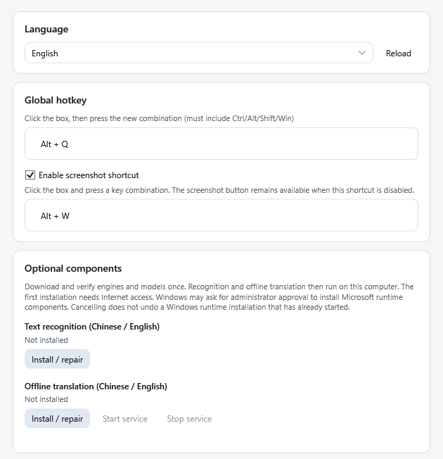
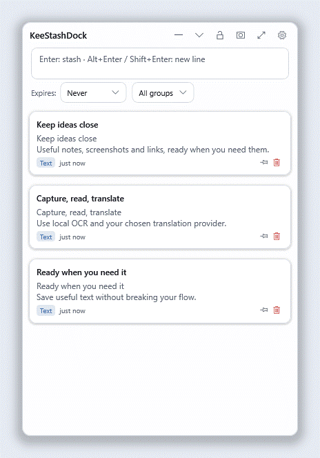
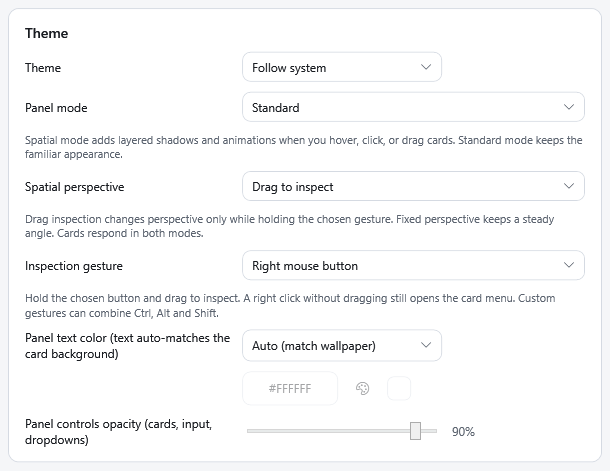
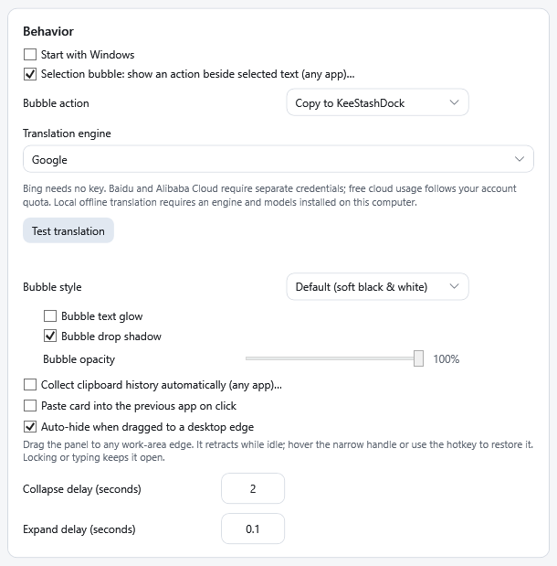
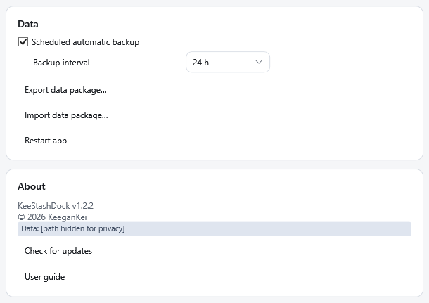

<h1 align="center">KeeStashDock</h1>

<p align="center">
  
</p>

<p align="center">
  <strong>Un panel portátil para Windows con el que guardar fragmentos, capturas de pantalla y reutilizar texto.</strong><br>
  Captura lo que necesites, organízalo localmente y tradúcelo cuando quieras.
</p>

<p align="center">
  <a href="README.md" lang="en">English</a> ·
  <a href="README.zh-CN.md" lang="zh-Hans">简体中文</a> ·
  <a href="README.zh-TW.md" lang="zh-Hant">繁體中文</a> ·
  <a href="README.ja-JP.md" lang="ja">日本語</a> ·
  <a href="README.ko-KR.md" lang="ko">한국어</a> ·
  <a href="README.de-DE.md" lang="de">Deutsch</a> ·
  <a href="README.fr-FR.md" lang="fr">Français</a> ·
  <a href="README.es-ES.md" lang="es">Español</a> ·
  <a href="README.pt-BR.md" lang="pt-BR">Português (Brasil)</a>
</p>

<p align="center">
  
  
  
  
</p>

> **Preparación de la versión 1.2.2:** esta guía describe la versión **1.2.2**. Los enlaces del ZIP y su suma de comprobación estarán disponibles cuando se publique la GitHub Release. Consulta las [notas de la versión](docs/releases/1.2.2-notes.md) y el [registro de aceptación](docs/releases/1.2.2.md) para conocer los cambios, las comprobaciones y los límites pendientes.

[Primeros pasos](#get-started) · [Funciones](#features) · [Atajos](#shortcuts) · [Datos y actualizaciones](#data-and-upgrades) · [Desarrollo](#development) · [Licencia](#license)

<a id="get-started"></a>
## Primeros pasos

**[Última versión publicada](https://github.com/Keegankei/KeeStashDock/releases/latest)** · **[ZIP para Windows x64 — 1.2.2](https://github.com/Keegankei/KeeStashDock/releases/download/v1.2.2/KeeStashDock-1.2.2-win-x64.zip)** · [Suma de comprobación SHA-256](https://github.com/Keegankei/KeeStashDock/releases/download/v1.2.2/KeeStashDock-1.2.2-win-x64.zip.sha256)

1. Descarga el ZIP de la aplicación en **Assets**, en lugar del archivo **Source code** de GitHub, destinado al desarrollo.
2. Extrae el paquete completo en una carpeta con permisos de escritura y ejecuta `KeeStashDock.exe`. Mantén juntas todas las carpetas que lo acompañan.
3. Pulsa **Alt+Q** para mostrar el panel rápido. Escribe un fragmento y pulsa **Enter** para guardarlo; haz clic en su tarjeta para copiarlo.
4. Abre **Configuración** desde el panel o la bandeja del sistema para elegir un idioma, un tema y los componentes opcionales.

El paquete para Windows x64 incluye .NET; no es necesario instalar .NET por separado. Windows 11 es la plataforma principal, con compatibilidad con Windows 10 22H2 en la medida de lo posible. El OCR y la traducción sin conexión pueden necesitar el entorno de ejecución de Visual C++ de Microsoft, que puede instalarse mediante el instalador de componentes integrado. Consulta el [registro de aceptación de la versión 1.2.2](docs/releases/1.2.2.md) para conocer el alcance de las pruebas.

<details>
<summary>Verificar el ZIP descargado</summary>

Ejecuta lo siguiente en la carpeta de descargas y compara el resultado con el archivo `.sha256` adjunto:

```powershell
Get-FileHash .\KeeStashDock-1.2.2-win-x64.zip -Algorithm SHA256
```

Una suma de comprobación verifica la integridad del archivo; no es una firma del editor. El paquete actual no está firmado.

</details>

**Valores iniciales · 1.2.2:** inglés; **Alt+Q** abre el panel y **Alt+W** inicia una captura. El OCR y la traducción local no vienen preinstalados. Las actualizaciones conservan las preferencias guardadas.

La burbuja de selección está activada en **Solo copiar**, con **Google** como traductor. Estilo predeterminado, brillo del texto desactivado y sombra activada. Inicio automático, recopilación del portapapeles y pegado directo desactivados. La ocultación en los bordes está activada, con **2 s** para contraer y **0,1 s** para expandir. Tema del sistema, modo **Estándar**, **inspección arrastrando con el botón derecho**, colores de texto automáticos y opacidad de los controles del **90 %**. Sin imagen de fondo; superposición al **20 %** y desenfoque desactivado, con radio guardado de **4 px**. Copias de seguridad automáticas activadas cada **24 horas**.

<details>
<summary>Ajustes de una instalación nueva · interfaz en inglés</summary>

<p align="center"></p>

</details>

<a id="features"></a>
## Funciones

Estas vistas previas muestran la **interfaz real en inglés de 1.2.2** con datos de ejemplo ficticios. El panel Estándar utiliza los ajustes de apariencia de una instalación nueva; el modo Espacial y la burbuja Copiar / Traducir muestran opciones configurables. El puntero del GIF del modo Espacial y la publicación de la vista previa de actualización son simulados. Las rutas de instalación y de datos están ocultas; no aparece contenido personal del escritorio ni del portapapeles. [Origen y reproducción de las imágenes](docs/images/README.md).

<p align="center"></p>

*Modo Estándar · escribir, guardar, fijar y desfijar · interfaz en inglés. Interacción automatizada con controles reales y datos de ejemplo.*

### 1. Capturar, buscar y organizar

<p align="center"></p>

Utiliza el panel rápido para capturas breves y el **área de trabajo** para gestionar tu colección. Abre el área de trabajo con el botón de ampliación del panel o desde la bandeja del sistema.

| Herramienta | Qué puedes hacer |
| --- | --- |
| Entrada rápida y búsqueda | Guarda texto con Enter; inserta saltos de línea con Alt+Enter o Shift+Enter; busca y filtra entradas en el área de trabajo. |
| Arrastrar al panel | Suelta texto para guardarlo, o archivos y carpetas para guardar sus rutas. Haz clic en una tarjeta de ruta para abrir su destino; elige **Copiar** en el menú del clic derecho para copiar la ruta. No se importa el contenido de los archivos. |
| Grupos, etiquetas y elementos fijados | Agrupa entradas relacionadas, edita su título, texto y etiquetas, y fija el contenido que utilices con frecuencia. |
| Caducidad y papelera | Elige sin caducidad, un día, siete días o eliminación tras la lectura; las entradas caducadas y eliminadas pasan a la papelera y pueden recuperarse. De forma predeterminada, las entradas de la papelera se eliminan permanentemente después de 30 días. |
| Notas adhesivas en el escritorio | Arrastra una tarjeta de texto o de ruta fuera del panel para conservarla como nota independiente en el escritorio durante la sesión actual. Al salir de la aplicación se cierran estas notas; las entradas guardadas permanecen en tu colección. Las tarjetas de imagen siguen siendo entradas de imagen. |
| Códigos QR | Haz clic con el botón derecho en una tarjeta de texto para mostrar un código QR de hasta 1800 caracteres. |
| Herramientas de texto | Usa el menú Transformar del área de trabajo para convertir mayúsculas y minúsculas, limpiar espacios en blanco, dar formato a JSON, codificar o descodificar URL y utilizar Base64. |
| Importación y exportación de grupos | Comparte paquetes `.ksdgrp` o carga conjuntos de comandos para Git, Docker, intérpretes de comandos y otras herramientas. Los paquetes con imágenes requieren una versión compatible de la aplicación. |
| Historial del portapapeles | Recopila automáticamente el **texto** copiado si activas esta opción; se ignoran los textos vacíos o demasiado grandes y no se añaden duplicados. Desactivado de forma predeterminada. |
| Pegado directo | Pega una entrada de texto copiada en la aplicación anterior si activas esta opción y puede confirmarse de forma segura la ventana de destino. Desactivado de forma predeterminada. |

### 2. Paneles Estándar y Espacial · 1.2.2

Selecciona **Configuración > Modo del panel**. Ambos modos mantienen los mismos controles, tipografía, colores y distribución de tarjetas.

<table>
  <tr><th>Estándar</th><th>Espacial</th></tr>
  <tr>
    <td></td>
    <td></td>
  </tr>
  <tr><td>Una presentación plana y estable con sombras suaves.</td><td>Perspectiva, respuesta independiente de las tarjetas y profundidad visible entre las capas.</td></tr>
</table>

<p align="center"></p>

*El puntero blanco muestra la respuesta de las tarjetas cercanas; el naranja indica la inspección mediante arrastre con el botón pulsado. Es una animación ilustrativa, no una prueba de velocidad de fotogramas.*

- **Perspectiva fija:** conserva una vista inclinada estable mientras las tarjetas cercanas responden al puntero.
- **Arrastrar para inspeccionar:** mantén pulsado el **botón derecho del ratón** sobre el cuerpo de una tarjeta o el fondo del panel y arrastra. Suelta para mantener el ángulo. Un clic derecho sin arrastrar sigue abriendo el menú de la tarjeta. La configuración también permite usar el botón central o una combinación personalizada de botón y teclas modificadoras.
- **Barra compacta:** contrae el panel a seis acciones: minimizar, expandir/contraer, bloquear, captura de pantalla, área de trabajo y Configuración. Al expandirlo, se recupera el tamaño anterior del panel.
- **Ocultar en el borde del escritorio:** activado por defecto en 1.2.2; arrastra el panel a uno de los cuatro bordes de la pantalla y aleja el puntero. Quedará un pequeño tirador; pasa el puntero sobre él o haz clic para recuperar el panel. El bloqueo lo mantiene visible.

Hay temas claro, oscuro y del sistema, con ajustes de fondo personalizado, opacidad y efecto esmerilado. Las preferencias del sistema de alto contraste y reducción de animaciones ofrecen alternativas estáticas. [Vista previa oscura](docs/images/floating-panel-dark.png) · [Vista previa fija](docs/images/floating-panel-fixed.png) · [Rendimiento medido y límites](docs/performance/1.2.2-floating.md).

La configuración también ofrece paletas de texto para el panel, un color de texto personalizado y contraste automático, además de controles independientes de estilo, resplandor, sombra y opacidad para la burbuja de selección.

<details>
<summary>Ajustes de apariencia predeterminados</summary>

<p align="center"></p>

</details>

### 3. Capturas de pantalla y reconocimiento local de texto

<p align="center"></p>

Pulsa **Alt+W** o un botón de captura y arrastra para seleccionar una zona. Las capturas guardadas se convierten en entradas de imagen dentro del grupo seleccionado. Abre una para verla, copiarla, guardarla como PNG o **Reconocer texto**. Puedes editar y buscar el texto reconocido conservando la imagen original.

**1.2.2:** después de seleccionar una zona, una barra de herramientas ofrece tres acciones independientes:

| Acción | Resultado |
| --- | --- |
| Guardar captura | Guarda una entrada de imagen. Enter selecciona esta acción. |
| Extraer texto | Ejecuta el OCR local y muestra texto temporal sin guardar una entrada ni copiarlo automáticamente. |
| Extraer y traducir | Ejecuta el OCR local y envía el texto reconocido al proveedor de traducción elegido. La captura de pantalla no se sube. |

<p align="center"></p>

Arrastra de nuevo para cambiar la selección; **Esc** o un clic derecho cancela la captura. Los resultados temporales permiten copiar de forma explícita, conservar el texto original si la traducción falla y volver a intentar la traducción. El OCR es un paso de reconocimiento; no traduce automáticamente. [Flujos de captura de pantalla](docs/SCREENSHOTS.md) · [Compatibilidad y límites del OCR](docs/LOCAL_OCR.md).

### 4. Acciones de selección y traducción

<p align="center"></p>

Activa la burbuja de selección en **Configuración > Comportamiento** y selecciona texto en otra aplicación. **Copiar** guarda la selección en el grupo actual del panel; **Traducir** muestra una traducción sin añadir una entrada.

**1.2.2:** elige **Copiar y traducir** para mantener ambos botones visibles. Después de copiar, puedes traducir la misma selección antes de que se cierre la burbuja. Si la traducción falla, se conserva el texto original.

El idioma de destino de la traducción sigue el idioma de la interfaz de la aplicación. Los idiomas de destino disponibles dependen del proveedor seleccionado o de los modelos sin conexión instalados.

| Proveedor | Configuración y disponibilidad |
| --- | --- |
| Bing (China), Google, Lingva | No requieren clave. La disponibilidad no está garantizada. Las nuevas instalaciones usan Google de forma predeterminada; se conservan las preferencias existentes. |
| Baidu, Alibaba Cloud, DeepL | Proporciona tus propias credenciales. Las cuotas gratuitas y los costes dependen del proveedor y de tu cuenta. Alibaba Cloud requiere activar el servicio Machine Translation y disponer del permiso `alimt:TranslateGeneral`. |
| Local sin conexión | Instala el motor local opcional; utiliza un servicio de bucle local sin necesidad de cuenta ni tarifas de API. |

La traducción en la nube envía únicamente el texto solicitado al proveedor seleccionado, sin cambiar automáticamente de proveedor. El OCR no sube imágenes. Las credenciales de los proveedores se almacenan **en texto plano** en el archivo local `settings.json`; ocultar los caracteres de los campos no los cifra.

<details>
<summary>Ajustes de selección y traducción predeterminados</summary>

<p align="center"></p>

</details>

### 5. Instalar componentes opcionales desde la aplicación

<p align="center"></p>

*Los ajustes de componentes muestran el estado de una instalación nueva de 1.2.2: OCR y traducción sin conexión no están instalados. Estos botones integrados permiten instalarlos sin comandos de terminal.*

1. Abre **Configuración > Componentes opcionales**.
2. Antes de usar el OCR por primera vez, elige **Instalar / reparar** en **Reconocimiento de texto (chino / inglés)**. El paquete 1.2.2 no preinstala motores ni modelos de OCR o traducción local. La instalación iniciada explícitamente descarga y verifica los archivos necesarios y comprueba el entorno de ejecución nativo.
3. Para la traducción local, elige **Instalar / reparar** en **Traducción sin conexión (chino / inglés)**. Mantén abierta la configuración durante la descarga inicial; reserva aproximadamente **1 GB de espacio libre en disco** y **2 GB de memoria disponible**.
4. Sigue el instalador de Microsoft si aparece. Si la instalación indica **Reinicio necesario**, reinicia Windows y vuelve a intentarlo. Cancelar la instalación en la aplicación no revierte una instalación del entorno de ejecución de Windows que ya haya comenzado.
5. Selecciona **Local sin conexión (Argos / LibreTranslate)** como motor de traducción. Mantén `http://127.0.0.1:5000` y utiliza **Probar traducción**. El servicio se inicia cuando hace falta; también están disponibles **Iniciar servicio** y **Detener servicio**.

La instalación inicial necesita acceso a Internet a los servidores de descarga correspondientes de NuGet, GitHub, Python, paquetes, modelos y Microsoft. Se puede reintentar una descarga fallida; se reutilizan los archivos válidos de la caché. Una vez instalados, el OCR y la traducción local funcionan sin conexión. El servicio de traducción sigue ejecutándose tras cerrar la aplicación hasta que se detiene.

**Idiomas compatibles:** el OCR admite texto impreso en inglés y chino simplificado. Los modelos de traducción de descarga opcional admiten **inglés ↔ chino simplificado**. Los **20 idiomas de la interfaz** no implican que el OCR o la traducción sin conexión admitan 20 idiomas. La ausencia de modelos nunca provoca un cambio a la traducción en la nube. [Instalación sin conexión y resolución de problemas](docs/OFFLINE_TRANSLATION.md).

### 6. Buscar actualizaciones · 1.2.2

<p align="center"></p>

*La publicación mostrada es simulada y la ruta de instalación está oculta. Esta imagen no anuncia una versión disponible.*

Utiliza **Buscar actualizaciones** en el menú de la bandeja o en **Configuración > Acerca de**. La búsqueda no descarga ni instala nada automáticamente. La descarga verifica el SHA-256 y el contenido del paquete; **Reiniciar y actualizar** requiere una confirmación independiente. El actualizador sustituye los archivos administrados de la aplicación en la ruta existente, conserva los datos del usuario y los componentes instalados, y mantiene información de recuperación si el inicio falla.

El paquete organizado contiene tres archivos en la raíz: `KeeStashDock.exe`, `StartHere.md` y `update-manifest.json`. Las guías están en `Docs` y los avisos legales en `Licenses`; los idiomas y los componentes opcionales conservan sus carpetas específicas. Mantén unido el paquete completo. [Actualizaciones y recuperación](docs/UPDATING.md).

<a id="shortcuts"></a>
## Atajos

| Acción | Atajo o gesto predeterminado |
| --- | --- |
| Mostrar/ocultar el panel rápido | **Alt+Q**; configurable |
| Guardar el texto escrito | **Enter** |
| Insertar un salto de línea | **Alt+Enter** o **Shift+Enter** |
| Captura de pantalla | **Alt+W**; configurable por separado |
| Guardar la zona de captura seleccionada | **Enter** en la barra de captura de la versión 1.2.2 |
| Cancelar la captura | **Esc** o clic derecho |
| Inspeccionar el panel Espacial | Mantener pulsado el **botón derecho del ratón** y arrastrar; configurable en la versión 1.2.2 |
| Copiar/traducir desde la burbuja de selección | **Ctrl+Alt+Shift+C** / **Ctrl+Alt+Shift+T** en la versión 1.2.2, solo mientras la burbuja esté visible y los atajos estén disponibles |

<a id="data-and-upgrades"></a>
## Datos, copias de seguridad y actualizaciones

<details>
<summary>Copias de seguridad · cada 24 horas por defecto</summary>

<p align="center"></p>

</details>

Las entradas, imágenes, textos reconocidos y copias de seguridad se almacenan localmente. Los datos portátiles suelen estar en `Data`, junto al ejecutable. Si esa carpeta no permite escritura, la aplicación utiliza `%AppData%\KeeStashDock` e informa de la ubicación alternativa en la configuración. Los componentes instalados desde la aplicación suelen utilizar `%LOCALAPPDATA%\KeeStashDock`, separados de tu colección.

Usa **Configuración > Datos** para exportar o importar una copia de seguridad y configurar copias programadas. La primera actualización desde **1.2.1 es manual**:

1. Exporta una copia de seguridad y sal de la aplicación desde el menú de la bandeja.
2. Extrae el nuevo ZIP en una carpeta aparte. Con la aplicación cerrada, copia **toda la carpeta de datos activa** a la carpeta `Data` de la nueva instalación. Si la configuración indica una ubicación alternativa en `%AppData%`, utiliza esa carpeta como origen.
3. Conserva la instalación original y la copia de seguridad. Inicia la nueva versión y comprueba tus entradas antes de eliminar las copias antiguas. Guarda una copia de seguridad anterior a la actualización para poder volver atrás; los esquemas antiguos de la base de datos no son intercambiables.
4. Si **Iniciar con Windows** estaba activado y has cambiado de carpeta, desactiva y vuelve a activar la opción en la configuración de la nueva aplicación. Así se registra la nueva ruta; de lo contrario, Windows podría iniciar la copia anterior al volver a iniciar sesión.

Las versiones candidatas anteriores de 1.2.2 también requieren sustitución manual, ya que comparten el número de la versión final. Conserva los datos y la copia de seguridad y sigue el mismo procedimiento.

No adjuntes tu carpeta personal `Data`, credenciales, copias de seguridad privadas ni registros a una incidencia. Consulta [asistencia e informes sin datos sensibles](SUPPORT.md), [recuperación tras una actualización](docs/UPDATING.md) y la [política de seguridad](SECURITY.md).

<a id="development"></a>
## Desarrollo y documentación

Compila en Windows con el SDK seleccionado por [`global.json`](global.json) (10.0.401 o una revisión compatible 10.0.4xx):

```powershell
dotnet restore KeeStashDock.sln
dotnet build KeeStashDock.sln --configuration Release --no-restore --disable-build-servers
dotnet test --solution KeeStashDock.sln --configuration Release --no-build
```

El inglés es la referencia de la documentación del repositorio. Los README traducidos comparten la misma estructura de funciones; las traducciones de la interfaz están en `Locales/*.json`. Las correcciones de traducción son bienvenidas siguiendo la [guía de contribución](CONTRIBUTING.md).

| Documentación | Contenido |
| --- | --- |
| [Registro de cambios](CHANGELOG.md) | Historial de versiones |
| [Arquitectura](docs/ARCHITECTURE.md) | Proyectos, responsabilidades y almacenamiento |
| [Localización](docs/LOCALIZATION.md) | Convenciones de traducción de la interfaz y de los README |
| [Proceso de publicación](docs/RELEASING.md) | Compilación, empaquetado y comprobaciones de aceptación |
| [Asistencia](SUPPORT.md) · [Código de conducta](CODE_OF_CONDUCT.md) | Preguntas, incidencias y participación en la comunidad |
| [Avisos de terceros](THIRD_PARTY_NOTICES.md) | Licencias de dependencias, entornos de ejecución y modelos |

<a id="license"></a>
## Licencia

Copyright © 2026 KeeganKei. Bajo licencia [Apache-2.0](LICENSE); consulta [NOTICE](NOTICE) para las atribuciones. Las dependencias, los entornos de ejecución opcionales y los modelos conservan sus propias licencias, recogidas en [THIRD_PARTY_NOTICES.md](THIRD_PARTY_NOTICES.md). La licencia del proyecto no concede derechos sobre marcas comerciales.

El icono de la aplicación se generó con IA bajo la dirección del responsable del proyecto. Su diseño y procedencia se documentan en [docs/assets/README.md](docs/assets/README.md).
