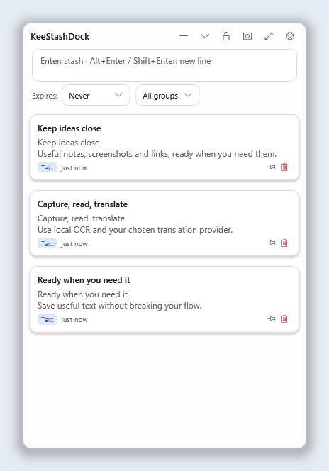
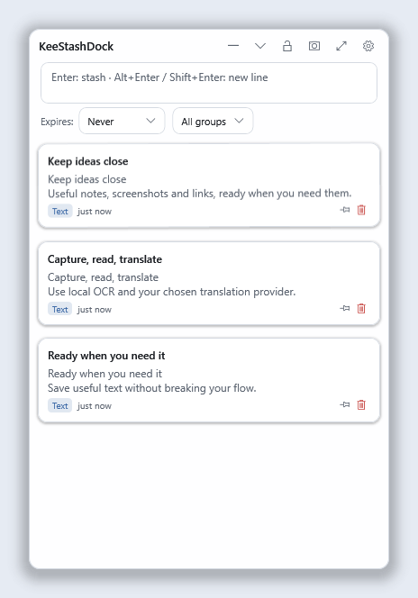
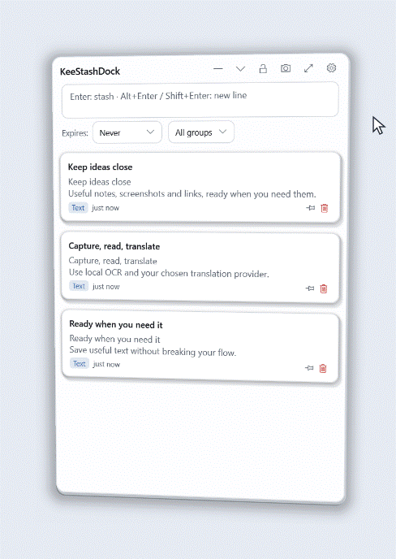
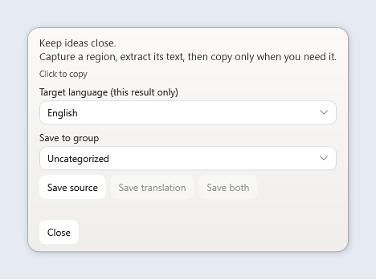
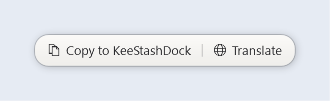
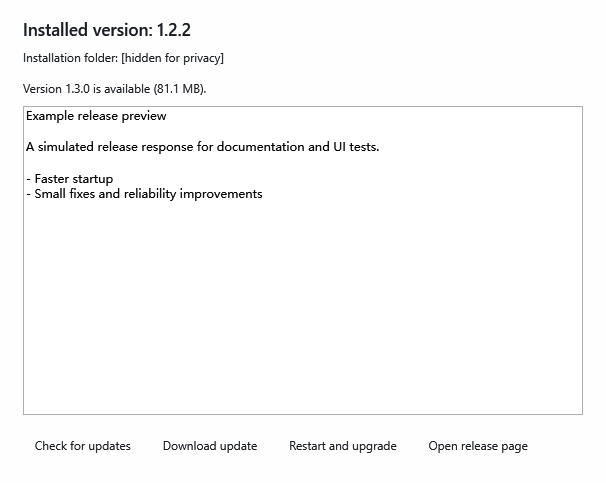

<h1 align="center">KeeStashDock</h1>

<p align="center">
  
</p>

<p align="center">
  <strong>Un panneau portable pour Windows, dédié aux extraits, aux captures d’écran et à la réutilisation de texte.</strong><br>
  Capturez ce qui vous intéresse, organisez-le localement et traduisez-le à votre demande.
</p>

<p align="center">
  <a href="README.md" lang="en">English</a> ·
  <a href="README.zh-CN.md" lang="zh-Hans">简体中文</a> ·
  <a href="README.zh-TW.md" lang="zh-Hant">繁體中文</a> ·
  <a href="README.ja-JP.md" lang="ja">日本語</a> ·
  <a href="README.ko-KR.md" lang="ko">한국어</a> ·
  <a href="README.de-DE.md" lang="de">Deutsch</a> ·
  <a href="README.fr-FR.md" lang="fr">Français</a> ·
  <a href="README.es-ES.md" lang="es">Español</a> ·
  <a href="README.pt-BR.md" lang="pt-BR">Português (Brasil)</a>
</p>

<p align="center">
  
  
  
  
</p>

> **État de la publication :** la version publiée est **1.2.1**. Cette branche prépare la version **1.2.2**. Les sections portant la mention **version candidate 1.2.2** décrivent des fonctionnalités en attente de publication ; les liens de téléchargement proposent toujours la version 1.2.1. Consultez le [rapport de validation de la version candidate](docs/releases/1.2.2.md).

[Premiers pas](#get-started) · [Fonctionnalités](#features) · [Raccourcis](#shortcuts) · [Données et mises à niveau](#data-and-upgrades) · [Développement](#development) · [Licence](#license)

<a id="get-started"></a>
## Premiers pas

**[Dernière version publiée](https://github.com/Keegankei/KeeStashDock/releases/latest)** · **[ZIP Windows x64 — 1.2.1](https://github.com/Keegankei/KeeStashDock/releases/download/v1.2.1/KeeStashDock-1.2.1-win-x64.zip)** · [Somme de contrôle SHA-256](https://github.com/Keegankei/KeeStashDock/releases/download/v1.2.1/KeeStashDock-1.2.1-win-x64.zip.sha256)

1. Téléchargez le ZIP de l’application dans la section **Assets**, plutôt que l’archive **Source code** de GitHub destinée au développement.
2. Extrayez l’intégralité du paquet dans un dossier accessible en écriture, puis lancez `KeeStashDock.exe`. Conservez tous les dossiers fournis avec l’application.
3. Appuyez sur **Alt+Q** pour afficher le panneau rapide. Saisissez un extrait et appuyez sur **Enter** pour l’enregistrer ; cliquez sur sa carte pour le copier.
4. Ouvrez les **Paramètres** depuis le panneau ou la zone de notification pour choisir la langue, le thème et les composants facultatifs.

Le paquet Windows x64 inclut .NET ; aucune installation séparée de .NET n’est nécessaire. Windows 11 est la plateforme principale ; la compatibilité avec Windows 10 22H2 est assurée dans la mesure du possible. L’OCR et la traduction hors ligne peuvent nécessiter le runtime Visual C++ de Microsoft, que l’installateur de composants intégré peut installer. Le [rapport de validation de la version 1.2.1](docs/releases/1.2.1.md) précise les vérifications effectuées.

<details>
<summary>Vérifier le ZIP téléchargé</summary>

Exécutez cette commande dans le dossier de téléchargement et comparez le résultat au fichier `.sha256` fourni :

```powershell
Get-FileHash .\KeeStashDock-1.2.1-win-x64.zip -Algorithm SHA256
```

Une somme de contrôle vérifie l’intégrité du fichier ; ce n’est pas une signature de l’éditeur. Le paquet actuel n’est pas signé.

</details>

<a id="features"></a>
## Fonctionnalités

Les aperçus ci-dessous montrent de véritables contrôles de l’application avec des données d’exemple fictives. Le GIF d’inspection est généré à partir de ces contrôles avec un pointeur simulé. L’aperçu de mise à jour utilise une publication simulée ; aucun contenu personnel du bureau ou du presse-papiers n’y figure. [Origine et reproduction des images](docs/images/README.md).

### 1. Capturer, rechercher et organiser

<p align="center"></p>

Utilisez le panneau rapide pour les captures ponctuelles et l’**espace de travail** pour gérer votre collection. Ouvrez l’espace de travail avec le bouton d’agrandissement du panneau ou depuis la zone de notification.

| Outil | Possibilités |
| --- | --- |
| Saisie rapide et recherche | Enregistrez du texte avec Enter ; insérez des sauts de ligne avec Alt+Enter ou Shift+Enter ; recherchez vos entrées au fil de la saisie. |
| Glisser dans le panneau | Déposez du texte pour l’enregistrer, ou des fichiers et dossiers pour enregistrer leurs chemins. Cliquez sur une carte de chemin pour ouvrir sa cible ; choisissez **Copier** dans le menu du clic droit pour copier le chemin. Le contenu des fichiers n’est pas importé. |
| Groupes, étiquettes et épinglage | Regroupez les entrées associées, modifiez leur titre, leur texte et leurs étiquettes, et épinglez les contenus fréquents. |
| Expiration et corbeille | Choisissez aucune expiration, un jour, sept jours ou la suppression après lecture ; les entrées expirées ou supprimées passent par la corbeille et peuvent être restaurées. Par défaut, les entrées de la corbeille sont supprimées définitivement après 30 jours. |
| Notes sur le bureau | Faites glisser une carte de texte ou de chemin hors du panneau pour la conserver comme note indépendante sur le bureau pendant la session en cours. Quitter l’application ferme ces notes ; les entrées enregistrées restent dans votre collection. Les cartes d’image restent des entrées contenant une image. |
| Codes QR | Cliquez avec le bouton droit sur une carte de texte pour afficher un code QR contenant jusqu’à 1 800 caractères. |
| Outils de texte | Utilisez le menu Transformer de l’espace de travail pour changer la casse, nettoyer les espaces, mettre en forme du JSON, encoder ou décoder des URL et utiliser Base64. |
| Import et export de groupes | Partagez des paquets `.ksdgrp` ou chargez des ensembles de commandes pour Git, Docker, les interpréteurs de commandes et d’autres outils. Les paquets contenant des images nécessitent une version compatible de l’application. |
| Historique du presse-papiers | Collectez automatiquement le **texte** copié si vous le souhaitez ; les textes vides ou trop volumineux sont ignorés et les doublons ne sont pas ajoutés. Désactivé par défaut. |
| Collage direct | Collez une entrée de texte copiée dans l’application précédente, si vous activez cette option et si sa fenêtre cible peut être confirmée de manière sûre. Désactivé par défaut. |

### 2. Panneaux Standard et Spatial · version candidate 1.2.2

Accédez à **Paramètres > Mode du panneau**. Les deux modes conservent les mêmes contrôles, la même typographie, les mêmes couleurs et la même disposition des cartes.

<table>
  <tr><th>Standard</th><th>Spatial</th></tr>
  <tr>
    <td></td>
    <td></td>
  </tr>
  <tr><td>Une présentation plane et stable, avec des ombres douces.</td><td>Une vue en perspective, des réactions propres à chaque carte et une profondeur visible entre les couches.</td></tr>
</table>

<p align="center"></p>

*Le pointeur blanc montre la réaction des cartes à proximité ; le pointeur orange indique une inspection par glissement avec le bouton maintenu. Cette animation illustre le fonctionnement et ne constitue pas une mesure de fréquence d’images.*

- **Perspective fixe :** conservez une vue inclinée stable pendant que les cartes proches réagissent au pointeur.
- **Glisser pour inspecter :** maintenez le **bouton droit de la souris** sur le corps d’une carte ou l’arrière-plan du panneau et faites glisser. Relâchez pour conserver l’angle. Un clic droit sans glissement ouvre toujours le menu de la carte. Les paramètres permettent aussi de choisir le bouton du milieu ou une combinaison personnalisée de bouton et de touches de modification.
- **Barre compacte :** réduisez le panneau à six actions : minimiser, déplier/replier, verrouiller, capture d’écran, espace de travail et Paramètres. Le déplier rétablit ses dimensions précédentes.
- **Masquer au bord du bureau :** activez cette option, faites glisser le panneau vers l’un des quatre bords de l’écran, puis éloignez le pointeur. Une petite poignée reste visible ; survolez-la ou cliquez dessus pour rétablir le panneau. Le verrouillage maintient le panneau visible.

Les thèmes clair, sombre et système sont disponibles, avec des réglages d’arrière-plan personnalisé, d’opacité et d’effet dépoli. Les préférences système de contraste élevé et de réduction des animations permettent un affichage statique de secours. [Aperçu sombre](docs/images/floating-panel-dark.png) · [Aperçu de la vue fixe](docs/images/floating-panel-fixed.png) · [Performances mesurées et limites](docs/performance/1.2.2-floating.md).

Les paramètres proposent aussi des palettes de texte pour le panneau, une couleur de texte personnalisée et un contraste automatique, ainsi que des réglages indépendants de style, de lueur, d’ombre et d’opacité pour la bulle de sélection.

### 3. Captures d’écran et reconnaissance locale du texte

<p align="center"></p>

Appuyez sur **Ctrl+Alt+S** ou sur un bouton de capture, puis faites glisser pour sélectionner une zone. Les captures enregistrées deviennent des entrées contenant une image dans le groupe sélectionné. Ouvrez-en une pour l’afficher, la copier, l’enregistrer au format PNG ou choisir **Reconnaître le texte**. Vous pouvez modifier le texte reconnu et y effectuer des recherches tout en conservant l’image d’origine.

**Version candidate 1.2.2 :** une barre d’outils apparaît après la sélection et propose trois actions distinctes :

| Action | Résultat |
| --- | --- |
| Enregistrer la capture | Enregistre une entrée contenant une image. Enter sélectionne cette action. |
| Extraire le texte | Lance l’OCR local et affiche un texte temporaire, sans enregistrer d’entrée ni le copier automatiquement. |
| Extraire et traduire | Lance l’OCR local, puis envoie le texte reconnu au fournisseur de traduction choisi. La capture elle-même n’est pas envoyée. |

<p align="center"></p>

Faites à nouveau glisser pour redéfinir la zone ; **Esc** ou un clic droit annule la capture. Les résultats temporaires permettent de copier explicitement le texte, de conserver le texte source en cas d’échec de traduction et de réessayer. L’OCR est une étape de reconnaissance ; il ne traduit pas automatiquement. [Parcours de capture d’écran](docs/SCREENSHOTS.md) · [Prise en charge et limites de l’OCR](docs/LOCAL_OCR.md).

### 4. Actions sur la sélection et traduction

<p align="center"></p>

Activez la bulle de sélection dans **Paramètres > Comportement**, puis sélectionnez du texte dans une autre application. **Copier** enregistre la sélection dans le groupe courant du panneau ; **Traduire** affiche une traduction sans ajouter d’entrée.

**Version candidate 1.2.2 :** choisissez **Copier et traduire** pour garder les deux boutons visibles. Après la copie, vous pouvez encore traduire la même sélection avant la fermeture de la bulle. Les échecs de traduction préservent le texte source.

La langue cible de la traduction suit la langue de l’interface de l’application. Les langues cibles disponibles dépendent du fournisseur sélectionné ou des modèles hors ligne installés.

| Fournisseur | Configuration et disponibilité |
| --- | --- |
| Bing (Chine), Google, Lingva | Aucune clé requise. La disponibilité n’est pas garantie. Les nouvelles installations utilisent Bing par défaut ; les préférences existantes sont conservées. |
| Baidu, Alibaba Cloud, DeepL | Fournissez vos propres identifiants. Les quotas gratuits et les frais dépendent du fournisseur et de votre compte. Alibaba Cloud nécessite l’activation du service Machine Translation et l’autorisation `alimt:TranslateGeneral`. |
| Local hors ligne | Installez le moteur local facultatif ; il utilise un service sur l’interface de bouclage, sans compte ni frais d’API. |

La traduction dans le cloud envoie uniquement le texte demandé au fournisseur sélectionné, sans changement automatique de fournisseur. L’OCR n’envoie pas d’images. Les identifiants des fournisseurs sont enregistrés **en clair** dans le fichier local `settings.json` ; le masquage des champs ne les chiffre pas.

### 5. Installer les composants facultatifs dans l’application

<p align="center"></p>

*Les contrôles des composants sont présentés dans leur état d’exemple non installé de la version 1.2.1. L’installation habituelle se fait avec ces boutons intégrés ; aucune commande de terminal n’est nécessaire.*

1. Ouvrez **Paramètres > Composants facultatifs**.
2. Pour l’OCR, choisissez **Installer / réparer** sous **Reconnaissance de texte (chinois / anglais)** si un composant est manquant. Le ZIP standard comprend déjà le moteur et les modèles anglais et chinois simplifié ; l’installation vérifie également le runtime natif.
3. Pour la traduction locale, choisissez **Installer / réparer** sous **Traduction hors ligne (chinois / anglais)**. Gardez les paramètres ouverts pendant le téléchargement initial ; prévoyez environ **1 Go d’espace disque libre** et **2 Go de mémoire disponible**.
4. Suivez l’installateur Microsoft s’il apparaît. Si l’installation indique **Redémarrage requis**, redémarrez Windows et réessayez. Annuler l’installation dans l’application n’annule pas une installation de runtime Windows déjà lancée.
5. Sélectionnez **Local hors ligne (Argos / LibreTranslate)** comme moteur de traduction. Conservez `http://127.0.0.1:5000`, puis utilisez **Tester la traduction**. Le service démarre à la demande ; les commandes **Démarrer le service** et **Arrêter le service** sont également disponibles.

L’installation initiale nécessite un accès Internet aux serveurs de téléchargement concernés de GitHub, Python, des paquets, des modèles et de Microsoft. Un téléchargement échoué peut être relancé ; les fichiers valides en cache sont réutilisés. Une fois installés, l’OCR et la traduction locale fonctionnent hors ligne. Le service de traduction continue à fonctionner après la fermeture de l’application, jusqu’à son arrêt explicite.

**Langues prises en charge :** l’OCR reconnaît l’anglais imprimé et le chinois simplifié imprimé. Les modèles de traduction inclus prennent en charge **anglais ↔ chinois simplifié**. Les **20 langues d’interface** de l’application ne signifient pas que l’OCR ou la traduction hors ligne prend en charge 20 langues. L’absence de modèles ne provoque jamais un passage à la traduction dans le cloud. [Installation hors ligne et dépannage](docs/OFFLINE_TRANSLATION.md).

### 6. Rechercher des mises à jour · version candidate 1.2.2

<p align="center"></p>

*La version et le chemin affichés servent d’exemple ; cette image n’annonce pas la disponibilité d’une nouvelle version.*

Utilisez **Rechercher des mises à jour** dans le menu de la zone de notification ou dans **Paramètres > À propos**. Une vérification ne télécharge ni n’installe quoi que ce soit automatiquement. Le téléchargement vérifie le SHA-256 et le contenu du paquet ; **Redémarrer et mettre à niveau** exige une confirmation distincte. Le programme de mise à jour remplace les fichiers gérés de l’application à l’emplacement existant, préserve les données utilisateur et les composants installés, et conserve des informations de récupération en cas d’échec du démarrage.

Le paquet réorganisé de la version candidate contient trois fichiers à la racine : `KeeStashDock.exe`, `StartHere.md` et `update-manifest.json`. Les guides se trouvent dans `Docs`, les mentions légales dans `Licenses` ; les langues et les composants facultatifs conservent leurs dossiers dédiés. Gardez l’intégralité du paquet ensemble. [Mises à jour et récupération](docs/UPDATING.md).

<a id="shortcuts"></a>
## Raccourcis

| Action | Raccourci ou geste par défaut |
| --- | --- |
| Afficher/masquer le panneau rapide | **Alt+Q** ; configurable |
| Enregistrer le texte saisi | **Enter** |
| Insérer un saut de ligne | **Alt+Enter** ou **Shift+Enter** |
| Capture d’écran | **Ctrl+Alt+S** ; configurable séparément |
| Enregistrer la zone de capture sélectionnée | **Enter** dans la barre d’outils de capture de la version 1.2.2 |
| Annuler la capture | **Esc** ou clic droit |
| Inspecter le panneau Spatial | Maintenir le **bouton droit de la souris** et faire glisser ; configurable dans la version 1.2.2 |
| Copier/traduire depuis la bulle de sélection | **Ctrl+Alt+Shift+C** / **Ctrl+Alt+Shift+T** dans la version 1.2.2, uniquement lorsque la bulle est visible et que les raccourcis sont disponibles |

<a id="data-and-upgrades"></a>
## Données, sauvegarde et mises à niveau

Les entrées, les images, le texte reconnu et les sauvegardes sont stockés localement. Les données portables se trouvent normalement dans `Data`, à côté de l’exécutable. Si ce dossier n’est pas accessible en écriture, l’application utilise `%AppData%\KeeStashDock` et signale ce changement dans les paramètres. Les composants installés depuis l’application utilisent normalement `%LOCALAPPDATA%\KeeStashDock`, séparément de votre collection.

Utilisez **Paramètres > Données** pour exporter ou importer une sauvegarde et configurer les sauvegardes planifiées. La première mise à niveau depuis **1.2.1 est manuelle** :

1. Exportez une sauvegarde, puis quittez l’application depuis le menu de la zone de notification.
2. Extrayez le nouveau ZIP dans un dossier distinct. L’application étant fermée, copiez **l’intégralité du dossier de données actif** dans le dossier `Data` de la nouvelle installation. Si les paramètres signalent un emplacement de secours dans `%AppData%`, utilisez ce dossier comme source.
3. Conservez l’installation d’origine et la sauvegarde. Lancez la nouvelle version et vérifiez vos entrées avant de supprimer les anciennes copies. Gardez une sauvegarde antérieure à la mise à niveau pour revenir en arrière ; les anciens schémas de base de données ne sont pas interchangeables.

Ne joignez pas de dossier `Data` personnel, d’identifiants, de sauvegardes privées ou de journaux à un ticket. Consultez [l’assistance et les rapports expurgés](SUPPORT.md), la [récupération après mise à niveau](docs/UPDATING.md) et la [politique de sécurité](SECURITY.md).

<a id="development"></a>
## Développement et documentation

Compilez sous Windows avec le SDK sélectionné par [`global.json`](global.json) (10.0.401 ou une mise à jour corrective compatible 10.0.4xx) :

```powershell
dotnet restore KeeStashDock.sln
dotnet build KeeStashDock.sln --configuration Release --no-restore --disable-build-servers
dotnet test --solution KeeStashDock.sln --configuration Release --no-build
```

L’anglais est la référence pour la documentation du dépôt. Les README traduits suivent la même structure fonctionnelle ; les traductions de l’interface se trouvent dans `Locales/*.json`. Les corrections de traduction sont les bienvenues selon le [guide de contribution](CONTRIBUTING.md).

| Documentation | Contenu |
| --- | --- |
| [Journal des modifications](CHANGELOG.md) | Historique des versions |
| [Architecture](docs/ARCHITECTURE.md) | Projets, responsabilités et stockage |
| [Localisation](docs/LOCALIZATION.md) | Conventions de traduction de l’interface et des README |
| [Processus de publication](docs/RELEASING.md) | Compilation, création des paquets et vérifications de validation |
| [Assistance](SUPPORT.md) · [Code de conduite](CODE_OF_CONDUCT.md) | Questions, signalements et participation à la communauté |
| [Mentions relatives aux tiers](THIRD_PARTY_NOTICES.md) | Licences des dépendances, runtimes et modèles |

<a id="license"></a>
## Licence

Copyright © 2026 KeeganKei. Distribué sous licence [Apache-2.0](LICENSE) ; consultez [NOTICE](NOTICE) pour les attributions. Les dépendances, runtimes facultatifs et modèles conservent leurs propres licences, recensées dans [THIRD_PARTY_NOTICES.md](THIRD_PARTY_NOTICES.md). La licence du projet n’accorde aucun droit sur les marques.

L’icône de l’application a été générée par IA sous la direction du responsable du projet. Sa conception et sa provenance sont documentées dans [docs/assets/README.md](docs/assets/README.md).
