<h1 align="center">KeeStashDock</h1>

<p align="center">
  
</p>

<p align="center">
  <strong>テキスト片、スクリーンショット、文章の再利用に使えるポータブルな Windows ドック。</strong><br>
  必要な内容を取り込み、ローカルで整理し、必要なときに翻訳できます。
</p>

<p align="center">
  <a href="README.md" lang="en">English</a> ·
  <a href="README.zh-CN.md" lang="zh-Hans">简体中文</a> ·
  <a href="README.zh-TW.md" lang="zh-Hant">繁體中文</a> ·
  <a href="README.ja-JP.md" lang="ja">日本語</a> ·
  <a href="README.ko-KR.md" lang="ko">한국어</a> ·
  <a href="README.de-DE.md" lang="de">Deutsch</a> ·
  <a href="README.fr-FR.md" lang="fr">Français</a> ·
  <a href="README.es-ES.md" lang="es">Español</a> ·
  <a href="README.pt-BR.md" lang="pt-BR">Português (Brasil)</a>
</p>

<p align="center">
  
  
  
  
</p>

**バージョン 1.3.0** · [リリースノート](docs/releases/1.3.0-notes.md) · [検証と公開の状況](docs/releases/1.3.0.md)

**リリース準備中：**このブランチでは 1.3.0 を説明しています。正式公開はまだ行われておらず、[最新リリース](https://github.com/Keegankei/KeeStashDock/releases/latest)では現在 **1.2.3** を配布しています。公開前に必要な残りの確認は検証記録に記載しています。

新しいプレビューは、隔離されたサンプルデータを使った **1.3.0 の英語画面**です。既存の画像と GIF は引き続き **1.2.3** と明記しています。イラスト付きテーマとコピー／翻訳を併用するバブルは任意の設定です。

[はじめに](#get-started) · [機能](#features) · [ショートカット](#shortcuts) · [データと更新](#data-and-upgrades) · [開発](#development) · [ライセンス](#license)

<a id="get-started"></a>
## はじめに

**[公開済みの最新リリースをダウンロード](https://github.com/Keegankei/KeeStashDock/releases/latest)**

1.3.0 のリリースでは、**Assets** に `KeeStashDock-1.3.0-win-x64.zip` と `KeeStashDock-1.3.0-win-x64.zip.sha256` を用意する予定です。これは公開予定のファイル名であり、すでにダウンロード可能であることを示すものではありません。

1. リリースページの **Assets** からアプリの ZIP をダウンロードします。GitHub の **Source code** アーカイブは開発者向けです。
2. パッケージ全体を書き込み可能なフォルダーに展開し、`KeeStashDock.exe` を起動します。付属フォルダーはすべて一緒に保管してください。
3. **Alt+Q** でクイックパネルを表示します。文章を入力して **Enter** で保存し、カードをクリックするとコピーできます。
4. パネルまたはシステムトレイから**設定**を開き、言語、テーマ、追加コンポーネントを選びます。

Windows x64 パッケージには .NET が含まれているため、別途インストールする必要はありません。主な対象は Windows 11 で、Windows 10 22H2 は可能な範囲で互換性を維持します。OCR とオフライン翻訳には Microsoft Visual C++ ランタイムが必要になる場合があり、アプリ内のコンポーネントインストーラーから導入できます。検証済みの範囲と残りの確認事項は [1.3.0 の検証記録](docs/releases/1.3.0.md)をご覧ください。

<details>
<summary>ダウンロードした ZIP を検証する</summary>

ダウンロード先のフォルダーで次のコマンドを実行し、結果を付属の `.sha256` ファイルと比較します。

```powershell
Get-FileHash .\KeeStashDock-1.3.0-win-x64.zip -Algorithm SHA256
```

チェックサムはファイルの整合性を確認するもので、発行元の署名ではありません。現在のパッケージは未署名です。

</details>

**初回起動時の既定値 · 1.3.0：**表示言語は英語。**Alt+Q** でパネルを開き、**Alt+W** で撮影します。OCR とローカル翻訳は事前インストールされません。更新時は既存の設定を保持します。

選択バブルは**コピーのみ**で有効、翻訳エンジンは **Google**。バブルは既定スタイルです。自動起動、クリップボードの自動収集、直接貼り付けはオフ。画面端での自動収納はオンで、収納まで **2 秒**、展開まで **0.1 秒**です。システムテーマ、**クラシック**モード、**右ボタンを押してドラッグ検視**、自動文字色、パネル部品の不透明度 **90%** が既定値です。背景画像はなく、オーバーレイは **20%**、ぼかしはオフで保存半径は **4 px**。自動バックアップは **24 時間**ごとに有効です。

文字サイズの初期値は **100%**、設定画面のサーフェス不透明度は **100%** です。設定画面のすりガラス効果は**オフ**です。同梱テーマは必要に応じて選択でき、自動では適用されません。

<details>
<summary>新規インストール時の設定 · 1.2.3 の英語プレビュー</summary>

<p align="center"></p>

</details>

<a id="features"></a>
## 機能

### 1.3.0 の新機能

| 機能 | 使い方 |
| --- | --- |
| クイックパネル検索 | パネルがアクティブな状態で **Ctrl+F**。タイトルや保存済みテキスト、既存の OCR 結果を検索し、グループ・タグ・テキスト／画像／テンプレートで絞り込めます。50 件ずつ追加読み込みできます。**Enter** で選択結果をコピー、**Esc** で取り込みに戻ります。入力中の下書きは保持されます。 |
| 一括整理 | ワークベンチで項目を選び、グループ移動、タグの追加・削除、固定・解除、ごみ箱への移動、復元をまとめて実行できます。**Ctrl+A の対象は読み込み済みの結果のみです。** 一括操作はまとめて確定し、競合時は何も変更しません。ごみ箱への移動後に項目が変更されていなければ、操作を元に戻せます。 |
| テキストテンプレート | テキスト項目を明示的にテンプレートに設定し、`{{date}}`、`{{time}}`、`{{name}}` などの変数を使えます。値を入力してプレビューを確認してからコピーします。原本は変更せず、スクリプトや式も実行しません。テンプレートを含むグループパッケージは v3 形式です。 |
| アプリ全体のテーマ | 各ウィンドウで統一されたライト／ダークの配色と背景をプレビューして適用できます。両方の外観と画像を一つのテーマ ZIP で読み込み・書き出しできます。クラシック／空間モードとは独立しており、プレビューのキャンセルで元の外観に戻ります。 |
| アプリ全体の文字サイズ | **設定 > 外観 > 文字サイズ**で **90%～150%** に調整できます。クイックパネル、ワークベンチ、設定などの文字に反映されます。**100%** で元の大きさに戻ります。 |
| ワークベンチの外観 | ナビゲーション、項目一覧、編集領域を設定画面と調和するデザインに更新しました。ダークモードの一覧やバックアップ行も背景と文字を読みやすく統一しています。 |
| コンパクトなバブル | 原文と結果のコピー操作を同じ行に配置し、翻訳先言語・グループ・保存操作をコンパクトにまとめました。既定スタイルと Wisteria Atelier は同じ操作構成を、それぞれの配色で表示します。 |
| 不透明度とすりガラス | 設定画面のサーフェスを **10%～100%** で個別に調整できます。任意のすりガラス効果は背景画像のみを **1～18 px** でぼかし、文字の鮮明さを維持します。バブルのスタイルと不透明度も個別に調整できます。 |

新規インストールの既定値は、英語、システムに合わせたテーマ、クラシックモード、背景画像なしのままです。更新時にイラストテーマを自動適用したり、保存済み設定をリセットしたりしません。

**設定：**カテゴリは**一般、取り込みと翻訳、外観、ローカルコンポーネント、バックアップとデータ、このアプリについて**です。関連する項目は必要な場合に表示され、非表示にしても保存済みの値は維持されます。

**取り込みと翻訳**では、結果ウィンドウの翻訳先言語の選択とグループへの保存操作を個別に表示・非表示にできます。どちらも既定で有効で、OCR または翻訳の完了後に表示されます。無効にしても結果の表示とコピーは利用できます。

バックアップ先は**バックアップとデータ**、OCR とオフライン翻訳の各フォルダーは**ローカルコンポーネント**で選択できます。変更しても**既存のファイルは移動しません**。新しいフォルダーが空ならコンポーネントを再インストールしてください。使用中のデータの場所は**このアプリについて**に読み取り専用で表示されます。ライブラリの移動にはエクスポートとインポートを使います。

以下の **1.3.0** ワークベンチ・テーマ・バブルのプレビューは、架空の内容を使って実際の WPF コントロールをオフスクリーン描画したものです。その他の **1.2.3** 画像と GIF は既存の操作を紹介しています。検視 GIF のポインターと更新画面のリリースは模擬のものです。インストール先やデータのパスはマスクされ、個人のデスクトップやクリップボードの内容は含みません。[画像の出典と再生成方法](docs/images/README.md)。

<p align="center"></p>

*1.2.3 · 標準モード · 入力、保存、ピン留めと解除 · 英語画面。実際のコントロールとサンプルデータに自動操作を適用しています。*

### 1. 取り込み、検索、整理

<p align="center">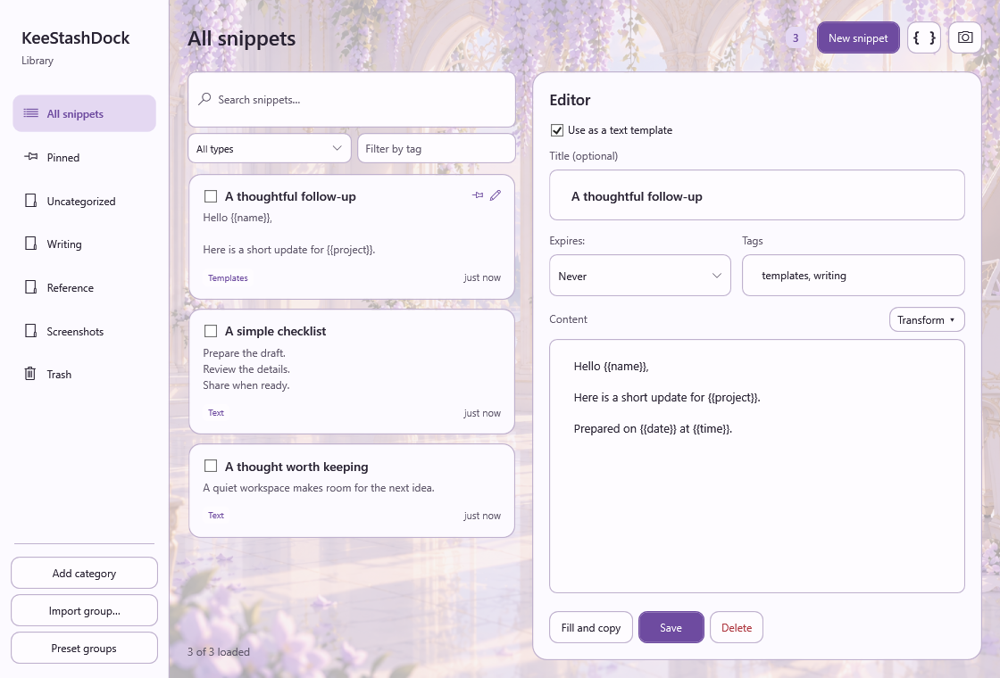</p>

*1.3.0 · ワークベンチとテキストテンプレート編集 · 任意の Wisteria Atelier ライトテーマ。*

短い内容の取り込みにはクイックパネル、コレクションの管理には**ワークベンチ**を使います。パネルの展開ボタンまたはトレイメニューからワークベンチを開けます。

| ツール | できること |
| --- | --- |
| 入力と検索 | Enter で保存、Alt+Enter または Shift+Enter で改行します。クイックパネルでは Ctrl+F で検索できます。パネルとワークベンチの両方でグループ、タグ、種類による絞り込みが可能です。 |
| ドックへドラッグ | 文章をドロップすると保存し、ファイルやフォルダーをドロップするとそのパスを保存します。パスのカードをクリックすると対象を開き、右クリックの**コピー**でパスをコピーできます。ファイルの内容は取り込みません。 |
| グループ、タグ、ピン留め | 関連する項目をまとめ、タイトル・本文・タグを編集し、よく使う内容をピン留めできます。 |
| 有効期限とごみ箱 | 無期限、1 日、7 日、使用後に削除から選択できます。期限切れや削除した項目はごみ箱に入り、復元できます。ごみ箱の項目は初期設定では 30 日後に完全削除されます。 |
| デスクトップ付箋 | テキストやパスのカードをパネルからドラッグすると、現在のセッション中は独立したデスクトップ付箋として表示できます。アプリを終了すると付箋は閉じますが、保存済みの項目はコレクションに残ります。画像カードは画像の項目として扱います。 |
| QR コード | テキストカードを右クリックすると、最大 1,800 文字の QR コードを表示できます。 |
| テキストツール | ワークベンチの変換メニューで、大文字・小文字変換、空白の整理、JSON 整形、URL のエンコード・デコード、Base64 処理を行えます。 |
| グループの入出力 | `.ksdgrp` パッケージを共有したり、Git、Docker、シェルなどのコマンド集を読み込んだりできます。テンプレートを含むパッケージは形式 3 を使用し、1.3.0 以降が必要です。形式 1 と 2 の読み込みも引き続き可能です。 |
| クリップボード履歴 | コピーした**テキスト**を自動収集する任意機能です。空の文章や大きすぎる文章は無視し、同じ内容を重複追加しません。初期設定では無効です。 |
| 直接貼り付け | 対象ウィンドウを安全に確認できる場合、コピーしたテキスト項目を直前のアプリに貼り付ける任意機能です。初期設定では無効です。 |

### 2. クラシックパネルと空間パネル

1.3.0 では「標準」を**クラシック**に改称しました。空間モードの名称は変わりません。旧版 1.2.3 の画像には以前の名称が残っています。

*この節のパネル画像と動作 GIF は 1.2.3 を示しています。*

**設定 > 外観 > パネル表示**で選びます。両モードとも、コントロール、書体、色、カードの配置は共通です。

<table>
  <tr><th>クラシック</th><th>空間</th></tr>
  <tr>
    <td></td>
    <td></td>
  </tr>
  <tr><td>柔らかな影を添えた、安定した平面表示。</td><td>透視表示と独立したカードの反応で、層の奥行きを表現。</td></tr>
</table>

<p align="center"></p>

*白いポインターは近くのカードの反応を、オレンジ色のポインターはボタンを押しながらのドラッグでの角度調整を示します。見た目の説明用アニメーションであり、フレームレートの測定ではありません。*

- **角度を固定：**傾斜した視点を固定し、近くのカードはポインターに反応します。
- **ドラッグで確認：**カードの本文またはパネルの背景で**マウスの右ボタン**を押しながらドラッグします。離すとその角度を保持します。ドラッグせずに右クリックすると、通常どおりカードのメニューが開きます。設定で中央ボタンや、ボタンと修飾キーの独自の組み合わせも選べます。
- **コンパクトバー：**パネルを折りたたむと、最小化、展開/折りたたみ、ロック、スクリーンショット、ワークベンチ、設定の 6 操作だけを表示します。展開すると元のパネルサイズに戻ります。
- **画面端に隠す：**既定で有効です。パネルを画面の四辺のいずれかに移動し、ポインターを離します。小さなハンドルが残り、ポイントまたはクリックすると戻せます。ロックすると表示を維持します。

どちらのモードでも、展開したパネルの辺や角をドラッグしてサイズを変更できます。再起動後は以前のサイズを復元します。6 ボタンのコンパクトバーは固定サイズです。

ライト、ダーク、システム連動のテーマに加え、背景画像、不透明度、すりガラス効果を設定できます。システムのハイコントラストやアニメーションを抑える設定では静的な表示に切り替わります。[ダーク表示](docs/images/floating-panel-dark.png) · [固定視点](docs/images/floating-panel-fixed.png)。

設定ではパネルの文字色パレット、独自の文字色、自動コントラストを選べます。選択バブルのスタイルと不透明度も個別に調整できます。

<details>
<summary>初期設定の外観</summary>

<p align="center"></p>

</details>

**設定 > 外観 > 背景画像**の**背景をカスタマイズ**で、**クイックパネル**または**設定ページ**を選びます。領域ごとに画像を選択・クリアし、オーバーレイとぼかしを個別に調整できます。**テーマの背景を使う**で、その領域のプリセット背景に戻ります。テーマの書き出しでは二つの背景を別々に保持し、個人用画像を含める前に共有の確認を求めます。

#### アプリ全体の外観テーマ

**設定 > 外観 > アプリ全体のテーマ**を開き、プリセットを選択して**プレビューして適用**を押します。ライト、ダーク、システムに合わせるを切り替え、選択バブルや結果画面もテーマに合わせるか選べます。**キャンセル**すると元の外観に戻ります。

| プリセット | 外観 |
| --- | --- |
| Sunlit Gallery | 人物のいないクリーム色の窓辺のギャラリー。日差しのある昼景と月明かりの夜景を用意しています。 |
| Twilight Study | 人物のいない濃いオリーブ色とウォールナットの書斎。昼と夜の背景を用意しています。 |
| Wisteria Atelier | アニメ調のピアニストと藤の空間。ライトとダークで調和する外観です。 |
| Wisteria Reverie | 藤の花と柔らかな光に包まれたアニメ調のピアニスト。横長／縦長の昼夜の背景と、調和するライト／ダーク配色を用意しています。 |

いずれも任意のテーマで、初期状態は背景画像なしです。**システムに合わせる**を選ぶと、システムの外観に従ってライト／ダークの配色と対応する昼／夜の画像が切り替わります。

[テーマガイドと背景プレビュー](docs/THEMES.md)。

<p align="center">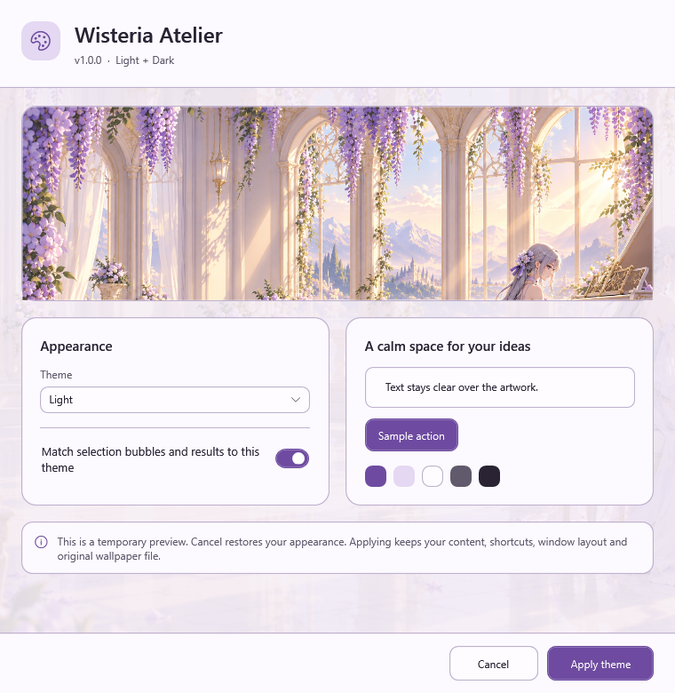</p>

**テーマをインポート**でテーマ ZIP を読み込み、**現在の外観をエクスポート**でライト／ダーク両方の配色、画像、外観設定を共有できます。個人の背景画像は明示的に選んだ場合のみ含まれます。テーマには項目、API キー、ホットキー、インストール済みコンポーネントは含まれません。テーマは実行ファイルの隣の `theme/` に保存され、更新時も `theme/custom/` のインポート済みテーマは保持されます。

**設定画面のサーフェス不透明度**はカード、ナビゲーション、入力欄の背景を調整し、文字を薄くしません。**設定の背景をすりガラスにする**は設定の背景画像のみをぼかし、初期値はオフです。設定画面に画像がない場合や高コントラスト時には、読みやすい不透明な背景を使用します。

<p align="center">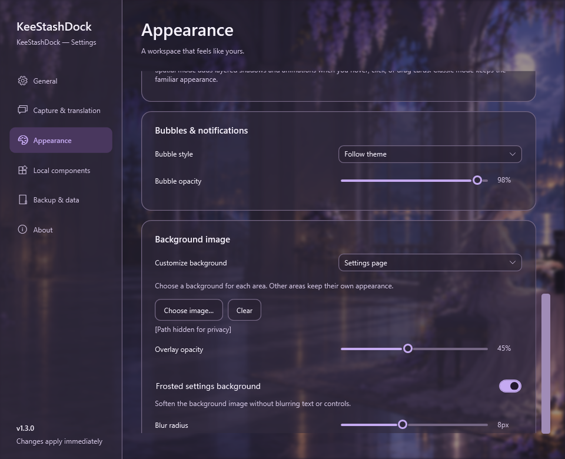</p>

*1.3.0 · 任意の Wisteria ダークテーマ、設定のサーフェス不透明度 60%、背景ぼかし 8 px。初回起動時の外観や、ネイティブのデスクトップぼかしを示す画像ではありません。*

### 3. スクリーンショットとローカル文字認識

*この節のスクリーンショット操作の画像は 1.2.3 を示しています。*

<p align="center"></p>

**Alt+W** またはスクリーンショットボタンを押し、ドラッグして範囲を選択します。保存した画像は選択中のグループの画像項目になります。開くとプレビュー、コピー、PNG 保存、**文字認識**を行えます。元画像を残しながら、認識した文章を編集・検索できます。

範囲選択後のツールバーに、3 つの独立した操作が表示されます。

| 操作 | 結果 |
| --- | --- |
| スクリーンショットを保存 | 画像の項目として保存します。Enter でも実行できます。 |
| 文字を抽出 | ローカル OCR を実行して一時的な文章を表示します。項目の保存や自動コピーは行いません。 |
| 抽出して翻訳 | ローカル OCR を実行し、認識した文章を選択済みの翻訳サービスへ送ります。スクリーンショット自体はアップロードしません。 |

<p align="center"></p>

もう一度ドラッグすると範囲を選び直せます。**Esc** または右クリックでキャンセルします。一時的な結果は自分でコピーでき、翻訳が失敗しても原文が残るため翻訳を再試行できます。OCR は文字認識を行う処理であり、自動では翻訳しません。[スクリーンショットの使い方](docs/SCREENSHOTS.md) · [OCR の対応範囲と制限](docs/LOCAL_OCR.md)。

一時的な OCR・翻訳結果には**原文を保存**、**訳文を保存**、**両方を保存**とグループ選択があります。最初は現在のグループを選びます。両方の保存は、原文と訳文を区別した一つのテキスト項目を作成します。保存は明示的な操作で行い、クリップボードを変更したり画像を同時保存したりしません。翻訳失敗時も原文を保存でき、保存失敗時は結果を保持して再試行できます。重複するテキストは既存の項目を再利用し、選択したグループに配置します。

### 4. 選択テキストの操作と翻訳

<table>
  <tr><th>1.3.0 · 既定スタイル</th><th>1.3.0 · Wisteria ダークスタイル</th></tr>
  <tr>
    <td>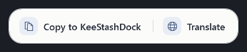</td>
    <td>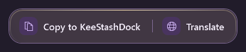</td>
  </tr>
</table>

*どちらの 1.3.0 プレビューも任意の「コピーと翻訳」モードを有効にしています。新規インストール時は「コピーのみ」です。*

**設定 > 取り込みと翻訳**で選択バブルを有効にし、別のアプリで文章を選択します。**コピー**は選択した文章をドックの現在のグループへ取り込み、**翻訳**は項目を追加せずに訳文を表示します。

**コピーと翻訳**を選ぶと両方のボタンを表示できます。コピー後も、バブルを閉じるまでは同じ選択内容を翻訳できます。翻訳に失敗しても原文は残ります。

設定で翻訳先の言語を表示言語とは別に選べます。新規インストールの既定値は**表示言語に従う**で、更新時は以前の選択を保持します。選択テキスト、スクリーンショット、翻訳テストで同じ設定を使用します。結果ウィンドウには実際の翻訳先が表示され、保持した原文を別の言語に再翻訳できます。この一時的な選択は現在の結果にのみ適用され、全体設定を変更しません。利用可能な言語はサービスとインストール済みモデルによって異なり、非対応の場合はエラーを表示します。サービスの自動切り替えやオフラインテキストのアップロードは行いません。

<table>
  <tr><th>1.3.0 · 既定スタイル</th><th>1.3.0 · Wisteria ダークスタイル</th></tr>
  <tr>
    <td>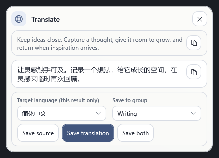</td>
    <td>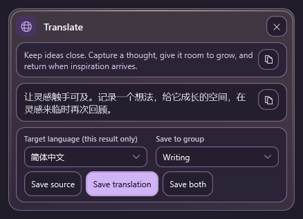</td>
  </tr>
</table>

*1.3.0 · 実際の結果コントロールに例文を事前入力しています。OCR や翻訳サービスは実行していません。両方の画像で翻訳先と保存操作を表示していますが、設定で個別に隠せます。*

| サービス | 設定と利用条件 |
| --- | --- |
| Bing（中国）、Google、Lingva | キーは不要ですが、利用可能性は保証されません。新規インストール時は Google が既定で、既存の設定は維持します。 |
| Baidu、Alibaba Cloud、DeepL | 自分の認証情報を設定します。無料枠や料金はサービスとアカウントによって異なります。Alibaba Cloud は機械翻訳サービスの有効化と `alimt:TranslateGeneral` 権限が必要です。 |
| ローカルオフライン | オプションのローカルエンジンをインストールします。ループバック上のサービスを使い、アカウントや API 料金は不要です。 |

クラウド翻訳は、翻訳を要求した文章だけを選択済みのサービスへ送ります。別のサービスへ自動で切り替わることはありません。OCR は画像をアップロードしません。サービスの認証情報はローカルの `settings.json` に**平文で**保存されます。入力欄の伏せ字表示は暗号化を意味しません。

<details>
<summary>選択アクションと翻訳の初期設定</summary>

<p align="center">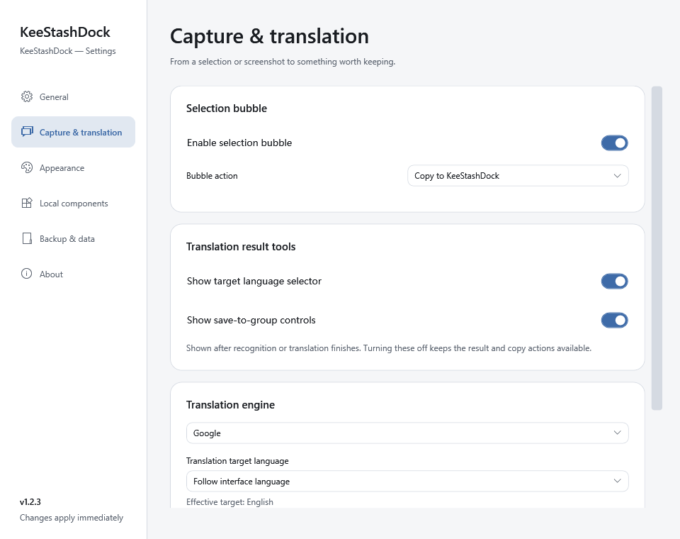</p>

</details>

### 5. アプリ内で追加コンポーネントを導入

<p align="center"></p>

*1.2.3 の新規インストール時のコンポーネント設定です。OCR とオフライン翻訳は未インストールです。アプリ内のボタンから導入でき、端末のコマンドは不要です。*

<details>
<summary>コンポーネントのインストール先</summary>

<p align="center">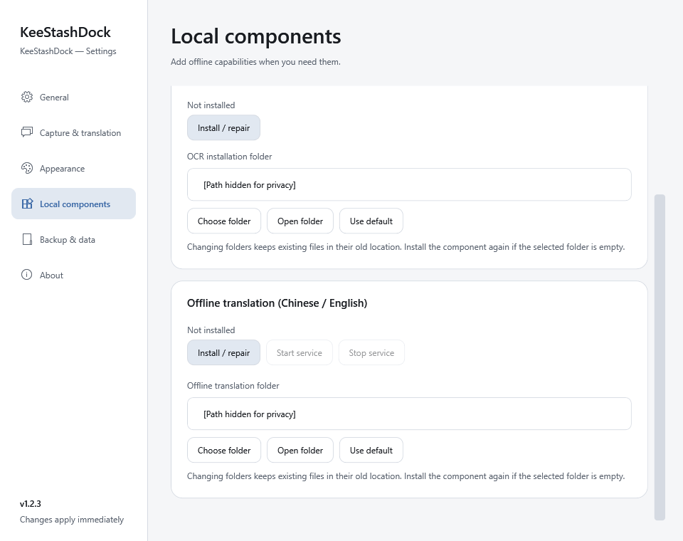</p>

*1.2.3 の英語画面にあるコンポーネントのフォルダー設定です。パスはマスクされています。*

</details>

1. **設定 > ローカルコンポーネント**を開きます。
2. OCR を初めて使う前に、**文字認識（中国語 / 英語）**の**インストール / 修復**を選びます。標準パッケージには OCR・ローカル翻訳のエンジンとモデルは事前インストールされません。明示的なセットアップで必要なファイルをダウンロードして検証し、ネイティブランタイムも確認します。
3. ローカル翻訳は、**オフライン翻訳（中国語 / 英語）**の**インストール / 修復**を選びます。初回ダウンロード中は設定を開いたままにし、約 **1 GB の空きディスク容量**と **2 GB の使用可能メモリ**を確保してください。
4. Microsoft のインストーラーが表示されたら、指示に従います。**再起動が必要**と表示された場合は、Windows を再起動して再試行してください。アプリのセットアップをキャンセルしても、開始済みの Windows ランタイムのインストールは取り消されません。
5. 翻訳エンジンで**ローカルオフライン（Argos / LibreTranslate）**を選び、`http://127.0.0.1:5000` を維持して**翻訳をテスト**を実行します。サービスは必要に応じて起動し、**サービスを開始**と**サービスを停止**も利用できます。

初回セットアップには、関連する NuGet、GitHub、Python、パッケージ、モデル、Microsoft のダウンロード先へのインターネット接続が必要です。失敗したダウンロードは再試行でき、検証済みのキャッシュは再利用します。インストール後は OCR とローカル翻訳をオフラインで利用できます。翻訳サービスはアプリを閉じた後も動作し、停止操作を行うまで継続します。

**対応言語：**OCR は印刷された英語と簡体字中国語に対応します。任意でダウンロードする翻訳モデルは**英語 ↔ 簡体字中国語**に対応します。アプリの**表示言語が 20 言語**あることは、OCR やオフライン翻訳の 20 言語対応を意味しません。モデルが不足してもクラウド翻訳へ自動で切り替わりません。[オフライン導入とトラブルシューティング](docs/OFFLINE_TRANSLATION.md)。

### 6. 更新の確認

<p align="center"></p>

*表示されるリリースは模擬のもので、インストール先はマスクされています。ダウンロード可能なリリースを告知する画像ではありません。*

トレイメニューまたは**設定 > このアプリについて**の**更新を確認**を使います。確認だけで自動的にダウンロードやインストールを行うことはありません。ダウンロード時に SHA-256 とパッケージの内容を検証し、**再起動して更新**には別途確認が必要です。更新プログラムは同じ場所の管理対象アプリファイルを置き換え、ユーザーデータと導入済みコンポーネントを維持し、起動に失敗した場合には復旧情報を残します。

整理されたパッケージのルートには、`KeeStashDock.exe`、`StartHere.md`、`update-manifest.json` の 3 ファイルを配置します。ガイドは `Docs`、ライセンス表記は `Licenses` に入り、言語と追加コンポーネントは専用フォルダーに保管します。パッケージ全体を一緒に保管してください。[更新と復旧](docs/UPDATING.md)。

<a id="shortcuts"></a>
## ショートカット

起動時にパネルやスクリーンショットのホットキーを登録できない場合、該当キーと設定への入口を通知し、設定画面にも状態を残します。トレイとボタンは使用できます。変更に失敗した場合は以前の有効な割り当てを維持します。

| 操作 | 既定のショートカットまたはジェスチャー |
| --- | --- |
| クイックパネルの表示／非表示 | **Alt+Q**。変更可能 |
| クイックパネルで検索 | パネルがアクティブな状態で **Ctrl+F**。**Esc** で取り込みに戻る |
| ワークベンチの結果を選択 | 一覧にフォーカスがある状態で **Ctrl+A**。読み込み済みの行のみ選択 |
| 入力した文章を保存 | **Enter** |
| 改行 | **Alt+Enter** または **Shift+Enter** |
| スクリーンショット | **Alt+W**、独立して設定可能 |
| 選択した撮影範囲を保存 | 撮影ツールバーで **Enter** |
| 撮影をキャンセル | **Esc** または右クリック |
| 空間パネルの角度を調整 | **マウスの右ボタン**を押しながらドラッグ。変更可能 |
| 選択バブルからコピー／翻訳 | **Ctrl+Alt+Shift+C** / **Ctrl+Alt+Shift+T**。バブルが表示され、ショートカットが利用可能な間のみ有効 |

<a id="data-and-upgrades"></a>
## データ、バックアップ、更新

**1.3.0 のデータベース互換性：**アプリはライブラリを **スキーマ 5** に更新します。旧データベースを変更する前に、コミット済みの WAL データを含む整合性のある安全バックアップを作成・検証します。バックアップが失敗すると移行を中止します。**1.2.3 以前はスキーマ 5 を開けません。** 旧アプリのファイルを復元しても、データベースは旧形式に戻りません。使用中のデータフォルダーと更新前のバックアップを両方保管し、旧版に戻す場合は新しいデータを上書きせず、対応するバックアップを別のコピーとして復元してください。

テーマは実行ファイルの隣の `theme/` に保存されます。`builtin/` はアプリ管理の素材、`custom/` は読み込んだユーザーテーマです。更新時も `theme/custom/` は保持されます。**データベースのバックアップにテーマは含まれません。** 設定のテーマ書き出し機能で、ライト／ダーク両方の外観と画像を別途移行・バックアップしてください。

設定で最終成功日時、前回の確認、次回の予定、状態、保存先、スナップショット数を確認できます。**今すぐバックアップ**、フォルダーを開く、安全な復元手順による一覧からの復元に対応します。間隔は **15／30／60 分**、6／12／24／48 時間、7 日で、既定値は **24 時間**です。既存の独自の間隔と保持数を維持します。15 分間隔で 7 個を保持しても、最古から最新までの範囲は **90 分**です。容量の見積もりと併せて保持数を選んでください。データベースに変更がなくても、予定されたバックアップごとに完全なスナップショットを作成します。短い間隔では保持履歴の入れ替わりも速くなります。対象は画像を含む項目データベースで、**設定・コンポーネント・背景のすべてを含むものではありません**。自動整理は手動エクスポートや復旧用コピーを削除しません。

<details>
<summary>バックアップ設定 · 初期値は 24 時間ごと</summary>

<p align="center"></p>

<p align="center">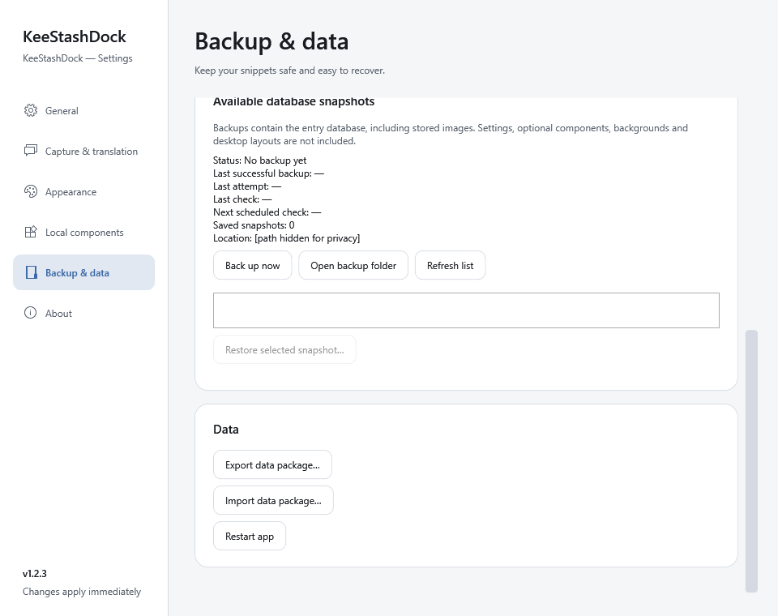</p>

*隔離されたサンプルデータでバックアップ状態、スナップショット、手動操作を示しています。パスはマスクされ、既定の間隔は引き続き 24 時間です。*

</details>

<details>
<summary>アプリ情報 · バージョンとデータの保存場所</summary>

<p align="center">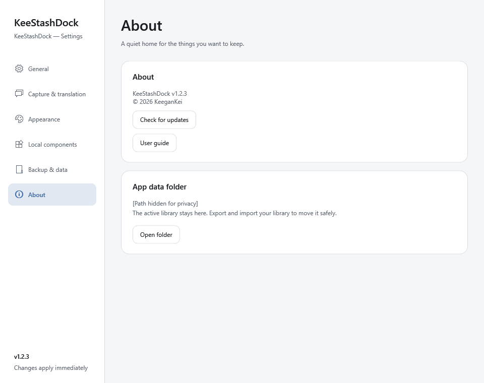</p>

</details>

項目、画像、認識した文章、バックアップはローカルに保存します。ポータブルデータは通常、実行ファイルの隣の `Data` に入ります。その場所に書き込めない場合は `%AppData%\KeeStashDock` を使用し、設定に代替の保存先を表示します。アプリ内で導入したコンポーネントは通常、コレクションとは別の `%LOCALAPPDATA%\KeeStashDock` に保存します。

**設定 > バックアップとデータ**でバックアップのエクスポート・インポートと定期バックアップを設定できます。**1.2.1 から初めて更新する場合は手動操作が必要**です。

1. バックアップをエクスポートし、トレイメニューからアプリを終了します。
2. 新しい ZIP を別のフォルダーに展開します。アプリを終了した状態で、**現在使用しているデータフォルダー全体**を新しいインストール先の `Data` フォルダーへコピーします。設定で `%AppData%` の代替保存先が表示されている場合は、そのフォルダーをコピー元にします。
3. 元のインストール先とバックアップを残します。新しいバージョンを起動し、項目を確認してから古いコピーを整理してください。元に戻せるよう更新前のバックアップを保管します。異なるバージョンのデータベース構造を自由に入れ替えることはできません。
4. **Windows 起動時に実行**を有効にしていて別のフォルダーへ移行した場合は、新しいアプリの設定で一度無効にしてから再度有効にしてください。新しい実行ファイルのパスが登録されます。変更しないと、次回のサインイン時に古いアプリが起動する場合があります。

**1.2.2** 以降では、**更新を確認**を使用するか、上記の手順で手動更新できます。**1.3.0 候補ビルド（r1–r5 を含む）**は正式版と同じ数値バージョンのため、手動で置き換えてください。使用中のデータフォルダー全体とバックアップを保管し、旧プロセスを完全に終了してから新しいアプリを起動してください。

個人の `Data`、認証情報、非公開のバックアップやログを Issue に添付しないでください。[サポートと個人情報を除いた報告](SUPPORT.md)、[更新時の復旧](docs/UPDATING.md)、[セキュリティポリシー](SECURITY.md)をご確認ください。

<a id="development"></a>
## 開発とドキュメント

Windows 上で [`global.json`](global.json) が指定する SDK（10.0.401 または互換性のある 10.0.4xx パッチ）を使ってビルドします。

```powershell
dotnet restore KeeStashDock.sln
dotnet build KeeStashDock.sln --configuration Release --no-restore --disable-build-servers
dotnet test --solution KeeStashDock.sln --configuration Release --no-build
```

リポジトリのドキュメントは英語版を基準とします。各言語の README は同じ機能構成に従い、インターフェースの翻訳は `Locales/*.json` に置きます。[コントリビューションガイド](CONTRIBUTING.md)に沿った翻訳の修正を歓迎します。

| ドキュメント | 内容 |
| --- | --- |
| [変更履歴](CHANGELOG.md) | バージョンの履歴 |
| [アーキテクチャ](docs/ARCHITECTURE.md) | プロジェクト、責務、ストレージ |
| [ローカライズ](docs/LOCALIZATION.md) | インターフェースと README の翻訳規約 |
| [リリース手順](docs/RELEASING.md) | ビルド、パッケージ化、受け入れ確認 |
| [サポート](SUPPORT.md) · [行動規範](CODE_OF_CONDUCT.md) | 質問、報告、コミュニティへの参加 |
| [第三者ライセンス表記](THIRD_PARTY_NOTICES.md) | 依存ライブラリ、ランタイム、モデルのライセンス |

<a id="license"></a>
## ライセンス

Copyright © 2026 KeeganKei。[Apache-2.0](LICENSE) の下で提供しています。帰属表示は [NOTICE](NOTICE) をご覧ください。依存ライブラリ、オプションのランタイム、モデルにはそれぞれのライセンスが適用され、[THIRD_PARTY_NOTICES.md](THIRD_PARTY_NOTICES.md) に記載しています。プロジェクトのライセンスは商標権を付与しません。

アプリのアイコンと同梱テーマの画像は AI 生成素材です。出典とライセンスについては、[アイコン](docs/assets/README.md)、[Sunlit Gallery](theme/builtin/sunlit-gallery/SOURCE.md)、[Twilight Study](theme/builtin/twilight-study/SOURCE.md)、[Wisteria Atelier](theme/builtin/wisteria-atelier/SOURCE.md)、[Wisteria Reverie](theme/builtin/wisteria-reverie/SOURCE.md)をご覧ください。
