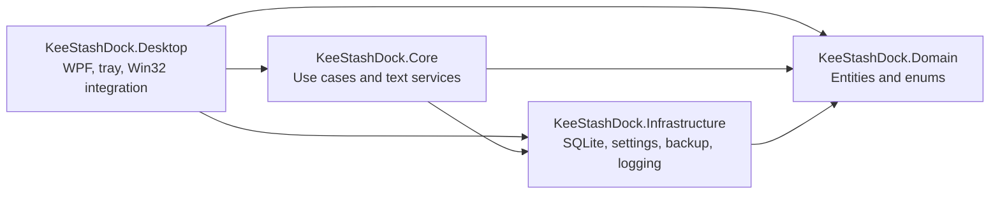

<h1 align="center">KeeStashDock</h1>

<p align="center">
  
</p>

<p align="center">
  <strong>A lightweight, portable text dock for Windows.</strong><br>
  Capture snippets from anywhere, find them quickly, and act on selected text without leaving your current workflow.
</p>

<p align="center">
  <a href="README.md">English</a> ·
  <a href="README.zh-CN.md">Simplified Chinese</a>
</p>

<p align="center">
  
  
  
  
</p>

> Current development version: **1.1.2**. 

KeeStashDock is a Windows tray application for temporary text storage and fast reuse. It combines a compact quick panel, a searchable workbench, selection actions, clipboard-assisted workflows, local persistence, portable backups, and extensive appearance and localization options.

## Highlights

- **Fast capture and recall:** stash text from the quick input, selected text, drag-and-drop, optional clipboard history, imported groups, or built-in command presets.
- **Organized retrieval:** browse recent, pinned, uncategorized, grouped, and trashed snippets; use SQLite FTS5 search with a CJK-compatible fallback.
- **Text actions:** copy, optional direct paste, translate selected text, transform content, tear cards into sticky notes, open recognized paths, and generate QR codes.
- **Retention controls:** keep snippets forever, expire them after one or seven days, or use burn-after-read behavior with recoverable soft deletion.
- **Portable local data:** SQLite, settings, logs, drafts, and backups live under a single `Data` directory, with an `%AppData%` fallback when the application folder is not writable.
- **Customizable interface:** light, dark, or system theme; wallpaper, scrim, blur, glow, opacity, text palettes, live language switching, and right-to-left layout support.

## Feature overview

### Capture

- Quick input from the dock panel
- Selection bubble with either **Capture** or **Translate** action
- Optional text-only clipboard history, disabled by default
- Drag-and-drop and group package import
- Seven built-in preset groups: Git, Docker, Linux Shell, PowerShell, npm/Node.js, Python/pip, and SQL
- SHA-256 content deduplication for live snippets

### Organize and search

- Categories, tags, pinning, source/type metadata, usage counts, and custom ordering
- Views for All, Pinned, Uncategorized, individual groups, and Trash
- Full-text search through SQLite FTS5, with `LIKE` fallback for CJK queries
- Group export and import through `.ksdgrp` JSON packages
- Soft deletion and scheduled housekeeping

### Reuse and transform

- Copy to clipboard and optional paste back into the previously focused application
- UPPERCASE, lowercase, whitespace collapse, line-break removal, JSON formatting, URL encode/decode, Base64 encode/decode, and text statistics
- Sticky-note tear-out from panel cards
- QR generation for text up to 1,800 characters
- File-path recognition and open-in-shell behavior

### Translation and localization

- Google, Bing, and Lingva keyless endpoints
- DeepL API support with a user-provided key
- 20 editable JSON language packs
- Live reload from Settings
- Right-to-left layout metadata, currently used by Arabic

## Privacy and data handling

KeeStashDock is local-first. Snippets, settings, logs, and backups are stored on the local machine. Clipboard history and direct paste are opt-in.

Translation is the main network-dependent feature: selected text is sent to the provider chosen in Settings. Google, Bing, Lingva, and DeepL are external services with their own availability and privacy terms. A DeepL key, when configured, is stored in the local `settings.json` file. Do not translate secrets or other sensitive content unless that disclosure is acceptable.

## Requirements

### Running a release build

- Windows 11 is the supported release-test baseline.
- Windows 10 22H2 may still run, but support is best-effort because Microsoft ended standard support on 2025-10-14; use an ESU-covered system where applicable.
- x64 processor for the supplied `win-x64` publish profile
- No separately installed .NET runtime when using the self-contained publish output

### Building from source

- Windows with the **.NET SDK 10.0.401** or a compatible later 10.0.4xx patch selected by `global.json`
- Visual Studio with the .NET desktop development workload, Visual Studio Code, Rider, or the `dotnet` CLI
- Git, when contributing through the normal pull-request workflow

## Quick start for users

1. Extract a release into a writable folder.
2. Start `KeeStashDock.exe`; the application remains available from the system tray.
3. Press **Alt+Q** to show or hide the quick panel. The shortcut is configurable in Settings.
4. Enter text and press **Enter** to create a snippet.
5. Click a card to copy it, or open the workbench for search, editing, grouping, and recovery.
6. Review Settings before enabling clipboard history, direct paste, selection translation, or automatic startup.

## Build, test, and publish

From the repository root:

```powershell
dotnet restore KeeStashDock.sln
dotnet build KeeStashDock.sln --configuration Release --no-restore
dotnet test --solution KeeStashDock.sln --configuration Release --no-build
```

Create the supported portable Windows package:

```powershell
dotnet restore src/KeeStashDock.Desktop/KeeStashDock.Desktop.csproj --runtime win-x64
dotnet publish src/KeeStashDock.Desktop/KeeStashDock.Desktop.csproj `
  --configuration Release `
  --no-restore `
  -p:PublishProfile=FolderProfile `
  --output artifacts/publish
```

The GitHub Actions workflow performs restore, Release build, tests, and a publish smoke check on Windows.

## Data layout

The preferred portable layout is:

```text
KeeStashDock.exe
Locales/
Data/
  keestashdock.db
  settings.json
  draft.txt
  Logs/
  Backups/
  Plugins/
```

When the executable directory is not writable, data is redirected to `%AppData%\KeeStashDock`. The `Plugins` directory is reserved for future extension work; this release does not expose a public plugin runtime.

## Architecture



| Project                       | Responsibility                                                                                                                     |
| ----------------------------- | ---------------------------------------------------------------------------------------------------------------------------------- |
| `KeeStashDock.Domain`         | Dependency-free entities, settings model, and persisted enums                                                                      |
| `KeeStashDock.Infrastructure` | SQLite schema and repositories, settings storage, file logging, portable paths, and backups                                        |
| `KeeStashDock.Core`           | Snippet, search, housekeeping, import/export, type-detection, and text-transformation use cases                                    |
| `KeeStashDock.Desktop`        | WPF windows and view models, tray lifecycle, hotkeys, clipboard/selection integration, localization, theming, QR, and sticky notes |
| `KeeStashDock.Tests`          | Unit tests plus repository, localization, and packaging policy checks                                                              |

A detailed component and data-flow description is available in [docs/ARCHITECTURE.md](docs/ARCHITECTURE.md).

## Repository documentation

- [Changelog](CHANGELOG.md)
- [Architecture](docs/ARCHITECTURE.md)
- [Localization guide](docs/LOCALIZATION.md)
- [Release process](docs/RELEASING.md)
- [Third-party notices](THIRD_PARTY_NOTICES.md)
- [Contributing](CONTRIBUTING.md)
- [Security policy](SECURITY.md)
- [Support policy](SUPPORT.md)
- [Code of Conduct](CODE_OF_CONDUCT.md)
- [Apache License 2.0](LICENSE)
- [Attribution notice](NOTICE)

## Contributing

Please read [CONTRIBUTING.md](CONTRIBUTING.md) before opening a pull request. Source code, comments, configuration, automation, and general documentation use English. `README.zh-CN.md` and the JSON files under `src/KeeStashDock.Desktop/Locales` are the intentional localization exceptions.

## License

Copyright © 2026 KeeganKei.

KeeStashDock is licensed under the [Apache License 2.0](LICENSE), an OSI-approved permissive open-source license. You may use, modify, and redistribute the software, including commercially, subject to the license terms. Preserve the required license, copyright, change, and attribution notices when redistributing the project or derivative works. See [NOTICE](NOTICE) for project attribution. The license does not grant rights to project names, logos, or other trademarks.
