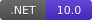
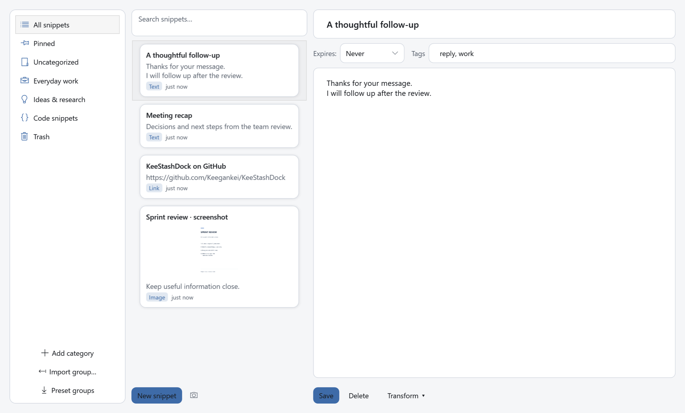
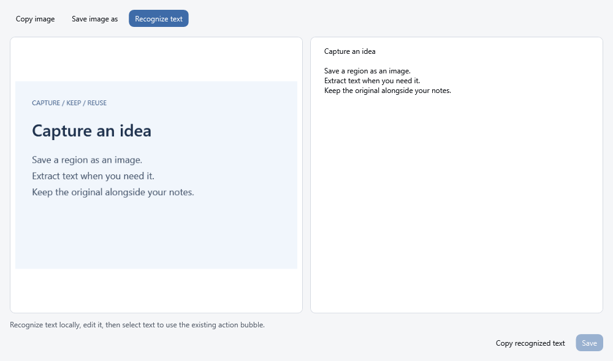
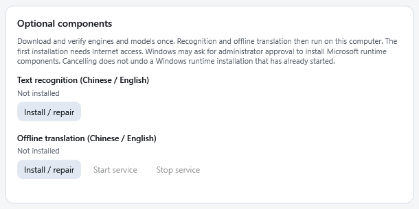

<h1 align="center">KeeStashDock</h1>

<p align="center">
  
</p>

<p align="center">
  <strong>A portable Windows dock for text, screenshots, and everyday reuse.</strong><br>
  Save a snippet, capture a region, recognize its text, and translate only when you choose.
</p>

<p align="center">
  <a href="README.md">English</a> ·
  <a href="README.zh-CN.md">Simplified Chinese</a> ·
  <a href="README.zh-TW.md">Traditional Chinese</a> ·
  <a href="README.ja-JP.md">Japanese</a>
</p>

<p align="center">
  
  
  
  
</p>

Current published release: **1.2.1**. This branch prepares **1.2.2**; its new features remain subject to the [candidate acceptance record](docs/releases/1.2.2.md). The download links below continue to point to the published release until 1.2.2 is released.

## New in the 1.2.2 candidate

- **Classic / Floating:** keep the familiar UI with soft shadows, layered cards and a thin panel side layer. Floating offers Fixed perspective or Drag to inspect: hold the right button and drag, then release to keep the angle. A plain right-click keeps the card menu. Middle-button and custom button/modifier gestures are available in Settings. Cards still respond to proximity; reduced-animation and high-contrast preferences disable motion effects.
- **Compact and edge modes:** the original 44-DIP compact bar keeps all six actions and restores the previous expanded size. Optional edge auto-hide leaves a 6-DIP-thick, 72-DIP-long handle on any of the four screen edges; hover to restore the panel.
- **Screenshot actions:** after selecting a region, save the image, extract text, or extract and translate. Enter saves; Esc/right-click cancels. Extraction alone creates no entry and copies nothing automatically.
- **Copy and translate:** the selection bubble can show two independent buttons. Copy retains capture-to-dock behavior; Translate uses the same selected text without creating an entry.
- **Check for updates:** open the tray menu or Settings > About. Downloads require a click and SHA-256 verification; replacement requires a separate restart confirmation. Only managed application files are replaced. Read [upgrade and recovery instructions](docs/UPDATING.md).

The revision-5 candidate package keeps `KeeStashDock.exe`, `StartHere.md` and `update-manifest.json` at its root, with guides, licenses, locales and component assets in named folders. Keep the extracted package together; portable `Data` remains beside the executable.

Candidate previews: [Classic](docs/images/classic-panel.png) · [Floating](docs/images/floating-panel.png) · [Hover and drag inspection](docs/images/floating-panel-motion.gif) · [Copy / Translate](docs/images/selection-actions.png) · [Extracted text](docs/images/screenshot-text.png) · [Update check](docs/images/update-check.png). [Image provenance](docs/images/README.md).

## Download and start

**[Latest release](https://github.com/Keegankei/KeeStashDock/releases/latest)** ·
**[Download 1.2.1 for Windows x64](https://github.com/Keegankei/KeeStashDock/releases/download/v1.2.1/KeeStashDock-1.2.1-win-x64.zip)** ·
[SHA-256 checksum](https://github.com/Keegankei/KeeStashDock/releases/download/v1.2.1/KeeStashDock-1.2.1-win-x64.zip.sha256)

1. Download the application ZIP from **Assets** on the release page. GitHub's **Source code** archives are for developers.
2. Extract the complete ZIP to a writable folder, then run `KeeStashDock.exe`. Keep the accompanying folders and files together.
3. Press **Alt+Q** to open the quick panel. The app also stays available in the Windows system tray.
4. Open **Settings** to choose your language, appearance, and optional components.

The package targets **Windows x64** and includes the .NET runtime. Windows 11 is the recommended platform; Windows 10 22H2 compatibility is best-effort. OCR and offline translation may need a Microsoft Visual C++ runtime, which the in-app component installer can install. See the [release notes](CHANGELOG.md) and [acceptance record](docs/releases/1.2.1.md) for tested coverage and remaining limits.

<details>
<summary>Verify the download (optional)</summary>

In PowerShell, run the following in the download folder and compare the result with the accompanying `.sha256` file:

```powershell
Get-FileHash .\KeeStashDock-1.2.1-win-x64.zip -Algorithm SHA256
```

</details>

## A look inside

### Main interface



Keep frequently used text close at hand. Search, pin, group, edit, and recover entries from Trash.

### Screenshot entry



Keep the original image and its editable recognized text together. OCR runs on demand; translation uses the existing selection bubble.

### Component setup



Install, repair, and manage optional components from Settings. These are actual application views rendered with sample data; see [image provenance](docs/images/README.md).

## Everyday use

| Action | How |
| --- | --- |
| Show or hide the quick panel | **Alt+Q**; configurable in Settings |
| Save typed text | Type in the quick input and press **Enter** |
| Insert a new line | **Alt+Enter** or **Shift+Enter** |
| Copy a text entry | Click its card; direct paste is an optional setting |
| Capture a region | Screenshot button or **Ctrl+Alt+S**; drag to select, **Esc** or right-click to cancel |
| Open an image entry | Click its card to preview, copy, save, or recognize text |
| Organize entries | Open the workbench for search, groups, tags, pinning, editing, and Trash |
| Translate selected text | Enable the selection bubble, choose **Translate**, and select a provider in Settings |

Additional tools include sticky notes, QR codes, text transformations, group import/export, retention policies, and optional clipboard history. Clipboard history and direct paste are off by default. The interface has 20 language packs and supports light, dark, and system themes.

## First-time OCR and offline translation setup

Normal setup uses buttons in the app; no terminal command is required.

1. Open **Settings > Optional components**.
2. For OCR, click **Install / repair** under **Text recognition (Chinese / English)** if recognition reports a missing component. The standard ZIP already includes the engine and English/Simplified Chinese models; the installer also checks the native runtime.
3. For offline translation, click **Install / repair** under **Offline translation (Chinese / English)**. Keep Settings open while the app downloads and verifies the files. Allow approximately **1 GB of free disk space** and **2 GB of available memory**.
4. If Windows requests permission to install Microsoft's runtime, follow its installer. If the app reports **Restart required**, restart Windows and retry component setup. Cancelling app setup does not undo a Windows runtime installation already started.
5. Choose **Local offline (Argos / LibreTranslate)** as the translation engine. Keep `http://127.0.0.1:5000` as the address and use **Test translation**. The installed engine starts when needed; Settings also offers **Start service** and **Stop service**.

Initial downloads require access to GitHub, python.org, files.pythonhosted.org, argos-net.com, and possibly Microsoft download hosts, depending on the component. Some networks may not reach these hosts. Failed setup can be retried and valid cached downloads are reused. After installation, recognition and local translation work offline. The translation service keeps running after the app closes until stopped.

OCR supports printed **English and Simplified Chinese**. The included translation models support **English ↔ Simplified Chinese**, not Japanese, Traditional Chinese, or every interface language. OCR does not translate automatically: select recognized text and use the translation bubble. Missing models never trigger a switch to cloud translation.

See [OCR setup and limits](docs/LOCAL_OCR.md), [offline translation setup and troubleshooting](docs/OFFLINE_TRANSLATION.md), and [screenshot workflows](docs/SCREENSHOTS.md).

## Translation choices and privacy

- **Bing (China), Google, and Lingva:** keyless options, with no guaranteed availability. New installations default to Bing; existing choices are preserved.
- **Baidu, Alibaba Cloud, and DeepL:** use your own provider credentials. Free quotas and charges depend on your account. Alibaba Cloud requires an activated Machine Translation service and permission for `alimt:TranslateGeneral`.
- **Local offline:** uses the installed local engine over loopback, with no account or API fee.

Text, images, recognized text, and backups stay in local storage. OCR does not upload images. Cloud translation sends the selected text to the chosen provider only; there is no automatic provider fallback. Provider credentials are stored **in plain text** in local `settings.json`; masked input fields do not encrypt them. Avoid sending sensitive content to a provider unless you accept that disclosure.

Offline translation accepts only loopback addresses, bypasses HTTP proxies, and rejects redirects. The included helper never downloads models while translating. See the [security policy](SECURITY.md) to report a vulnerability privately.

## Data, backup, and upgrades

Data normally lives in `Data` beside the executable, including the SQLite database, settings, drafts, logs, and backups. If the application folder is not writable, the app uses `%AppData%\KeeStashDock`; Settings reports that fallback. Components installed through the app normally use `%LOCALAPPDATA%\KeeStashDock` and are separate from your entries.

Before upgrading:

1. Export a backup from **Settings > Data**, then exit KeeStashDock from its tray menu.
2. Extract the new ZIP into a separate folder. For a portable installation, copy the **entire `Data` folder** from the old installation into the new folder while the app is closed. Keep the original as a rollback copy.
3. If Settings reports the `%AppData%` fallback, back up that folder too. To move to a writable portable folder, copy its complete contents into the new `Data` folder before first launch; otherwise the new app may show an empty library.
4. Start the new version and check your entries. Do not delete the old copy or backups until satisfied. Keep a pre-upgrade backup for rollback instead of opening an upgraded database in an older release.

Do not share your `Data` folder, credentials, private backups, or logs in an issue. [Support](SUPPORT.md) explains how to provide a sanitized report.

## Build and contribute

Use Windows and the **.NET SDK selected by `global.json`** (10.0.401 or a compatible 10.0.4xx patch):

```powershell
dotnet restore KeeStashDock.sln
dotnet build KeeStashDock.sln --configuration Release --no-restore --disable-build-servers
dotnet test --solution KeeStashDock.sln --configuration Release --no-build
```

See [CONTRIBUTING.md](CONTRIBUTING.md) for setup, optional helper tests, coding conventions, and publish checks. Source code and general documentation use English; localized `README.<locale>.md` files and interface language packs are the exceptions. English documentation is the reference when translations differ.

| Documentation | Purpose |
| --- | --- |
| [Changelog](CHANGELOG.md) | Changes by version |
| [Architecture](docs/ARCHITECTURE.md) | Projects, responsibilities, and data flow |
| [Localization](docs/LOCALIZATION.md) | Translate the interface |
| [Release process](docs/RELEASING.md) | Packaging and acceptance checks |
| [Support](SUPPORT.md) · [Code of Conduct](CODE_OF_CONDUCT.md) | Community participation |
| [Third-party notices](THIRD_PARTY_NOTICES.md) | Dependency and model licenses |

## License

Copyright © 2026 KeeganKei. Licensed under the [Apache License 2.0](LICENSE); see [NOTICE](NOTICE) for attribution. Dependencies, optional runtimes, and models retain their own licenses, described in [THIRD_PARTY_NOTICES.md](THIRD_PARTY_NOTICES.md). The project license does not grant trademark rights.

The application icon was AI-generated under the maintainer's direction; see its [design and provenance record](docs/assets/README.md).
