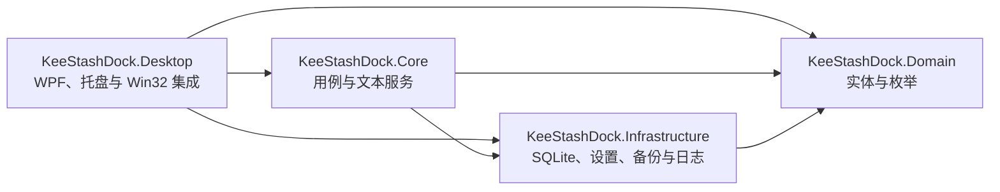

<h1 align="center">KeeStashDock（文本坞）</h1>

<p align="center">
  
</p>

<p align="center">
  <strong>轻量、绿色便携的 Windows 文本坞。</strong><br>
  随手收纳文本片段、快速检索，并在不打断当前工作的情况下处理任意应用中选中的文字。
</p>

<p align="center">
  <a href="README.md">English</a> ·
  <a href="README.zh-CN.md">简体中文</a>
</p>

<p align="center">
  
  
  
  
</p>

> 当前开发版本：**1.1.2**。

KeeStashDock 是一款常驻系统托盘的 Windows 文本效率工具，面向临时文本收纳与高频复用场景。它将速览面板、可搜索工作台、划词操作、剪贴板辅助流程、本地持久化、便携备份、外观定制和多语言支持整合在一个桌面应用中。

## 核心亮点

- **截图条目：** 点击截图按钮或按可配置的 **Ctrl+Alt+S** 框选截图，保留原图，并可按需在本地识别英文和简体中文。
- **快速收纳与找回：** 支持快速输入、划词收纳、拖放、可选剪贴板历史、分组导入和内置命令预设。
- **结构化管理：** 可查看最近、已钉选、未分组、各分组及回收站内容；SQLite FTS5 全文搜索同时提供适配中日韩查询的回退路径。
- **直接处理文本：** 支持复制、可选直接粘贴、划词翻译、文本变换、撕出悬浮便签、打开识别出的路径和生成二维码。
- **完整留存策略：** 支持永不过期、1 天、7 天和阅后即焚；删除采用可恢复的软删除机制。
- **本地绿色数据：** SQLite、设置、日志、草稿和备份统一存放在 `Data` 目录；应用目录不可写时自动回退到 `%AppData%`。
- **高度可定制：** 浅色、深色或跟随系统主题，并支持壁纸、蒙层、模糊、不透明度、文字色板、语言热切换和从右到左布局。

## 功能概览

### 内容收纳

- 框选截图保存到当前分组，按 Esc 或右键取消
- 文本坞速览面板快速输入
- 划词气泡可选择“收纳”或“翻译”动作
- 文本型剪贴板历史，默认关闭
- 拖放和分组包导入
- 七组内置预设：Git、Docker、Linux Shell、PowerShell、npm/Node.js、Python/pip 和 SQL
- 使用 SHA-256 对未删除内容去重

### 组织与检索

- 分组、标签、钉选、来源、类型、使用次数和自定义排序
- 全部、已钉选、未分组、单独分组及回收站视图
- SQLite FTS5 全文搜索，并对中日韩查询使用 `LIKE` 回退
- 通过 `.ksdgrp` JSON 包导入、导出分组，同时保留图片与识别文字
- 软删除、到期处理与定时清理

### 复用与变换

- 复制到剪贴板，并可选自动粘贴回之前获得焦点的应用
- 大写、小写、空白折叠、去除换行、JSON 格式化、URL 编解码、Base64 编解码和文本统计
- 从面板卡片拖出桌面悬浮便签
- 为不超过 1,800 个字符的文本生成二维码
- 识别文件路径并交由系统打开

### 截图条目与 OCR

每个图片条目同时保留 PNG 原图、缩略图和可编辑的识别文字。打开条目可查看、复制、另存图片，或点击“识别文字”。首版按需在本地识别印刷体英文和简体中文，不会自动触发翻译。选中识别结果中的文字，即可调用已有划词气泡；收纳／翻译动作及翻译服务均沿用软件设置。

图片与条目一起参与数据库备份、分组导出、回收站恢复及永久删除。旧版文本数据库及 v1 分组包仍可导入；包含图片的 v2 分组包需要本版或更新版本。详见[截图流程与升级说明](docs/SCREENSHOTS.md)和[本地 OCR 安装说明](docs/LOCAL_OCR.md)。

### 翻译与本地化

- Bing 中国入口（`cn.bing.com`），无需用户密钥，新安装默认使用
- 保留 Google、Lingva 免密钥选项及已有的服务商设置
- 百度官方翻译 API，需自备 App ID 和密钥，免费额度以账户为准
- 用户自备独立密钥的 DeepL API
- 阿里云通用翻译 API，独立保存 AccessKey ID 与 Secret，需开通服务并遵循账户额度及计费规则
- 本地离线翻译，可选安装中英模型，支持本机 Argos / LibreTranslate 兼容引擎
- 设置页支持使用固定示例测试翻译，无需读取剪贴板
- 区分超时、网络、凭据、限流和额度不足等失败原因
- 20 个可编辑 JSON 语言包
- 在设置中即时切换和重新载入
- 通过语言元数据支持从右到左布局，目前用于阿拉伯语

## 隐私与数据处理

KeeStashDock 采用本地优先设计。文本片段、截图、识别文字、设置、日志和备份保存在本机；OCR 不上传图片，也不会自动翻译识别文字；剪贴板历史与直接粘贴均为主动开启项。

云端翻译只会把所选文本发送到设置中选定的服务商，失败时不会自动转发给其他服务商。Bing、百度、阿里云、Google、Lingva 和 DeepL 均属于外部服务，其可用性与隐私条款由对应服务商决定。各服务凭据分别以明文保存在本机 `settings.json` 中；输入框隐藏密钥不等于加密存储。免费公共端点不保证长期可用。除非可以接受向所选服务披露内容，否则不要翻译密码、令牌、私密资料等敏感文本。

本地离线翻译只向本机回环地址发送文本，绕过 HTTP 代理，并拒绝远程地址和重定向。随附的可选离线引擎在翻译时不会联网下载模型；首次安装需要网络和磁盘空间。安装方式见 [离线翻译说明](docs/OFFLINE_TRANSLATION.md)。

## 环境要求

### 运行发布版本

- Windows 11 是正式发布测试的基准系统。
- Windows 10 22H2 可能仍可运行，但微软已于 2025-10-14 结束常规支持，因此项目仅提供尽力支持；适用时应使用已加入 ESU 的系统。
- 使用现有 `win-x64` 发布配置时需要 x64 处理器
- 使用自包含发布目录时，无须单独安装 .NET 运行时

### 从源码构建

- Windows，以及 **.NET SDK 10.0.401**；`global.json` 允许使用兼容的后续 10.0.4xx 补丁版本
- 安装了 .NET 桌面开发工作负载的 Visual Studio、Visual Studio Code、Rider 或 `dotnet` CLI
- 通过标准 Pull Request 流程贡献时需要 Git

## 用户快速开始

1. 将发布压缩包解压到具有写权限的目录。
2. 启动 `KeeStashDock.exe`；应用将常驻系统托盘。
3. 按 **Alt+Q** 显示或隐藏速览面板；可在设置中修改该热键。
4. 输入文本并按 **Enter** 创建片段；按 **Alt+Enter** 或 **Shift+Enter** 在光标处换行。
5. 点击文本卡片复制内容，点击图片卡片查看原图。点击截图按钮或按 **Ctrl+Alt+S** 框选截图；可在设置中修改或停用此快捷键。打开工作台可执行搜索、编辑、分组与恢复。
6. 启用剪贴板历史、直接粘贴、划词翻译或开机启动前，请先阅读对应设置说明。

**阿里云翻译：** 在设置中将划词动作改为“翻译”，选择“阿里云”，填写自己的 AccessKey ID 和 Secret。先开通[机器翻译服务](https://help.aliyun.com/zh/machine-translation/developer-reference/api-alimt-2018-10-12-translategeneral)，使用具有 `alimt:TranslateGeneral` 权限的 RAM 身份，并确认[免费额度及超额计费规则](https://help.aliyun.com/zh/machine-translation/product-overview/billing-overview)。点击“测试翻译”会发送固定示例，不读取剪贴板。

**本地离线翻译：** 选择“本地离线”，点击“打开离线安装目录”，按目录内 README 安装并启动引擎。默认地址为 `http://127.0.0.1:5000`。初始模型支持英语与简体中文；其他目标语言需要在兼容引擎中安装相应模型，模型缺失时不会自动切换到云端。

## 构建、测试与发布

在工程根目录执行：

```powershell
dotnet restore KeeStashDock.sln
dotnet build KeeStashDock.sln --configuration Release --no-restore
dotnet test --solution KeeStashDock.sln --configuration Release --no-build
```

生成受支持的 Windows 绿色便携发布目录：

```powershell
dotnet restore src/KeeStashDock.Desktop/KeeStashDock.Desktop.csproj --runtime win-x64
dotnet publish src/KeeStashDock.Desktop/KeeStashDock.Desktop.csproj `
  --configuration Release `
  --no-restore `
  -p:PublishProfile=FolderProfile `
  --output artifacts/publish
```

GitHub Actions 会在 Windows 环境完成还原、Release 构建、测试和发布冒烟检查。

## 数据目录

首选的绿色便携目录结构如下：

```text
KeeStashDock.exe
Locales/
Data/
  keestashdock.db
  settings.json
  draft.txt
  Logs/
  Backups/
  Plugins/
```

当程序所在目录不可写时，数据会重定向到 `%AppData%\KeeStashDock`。`Plugins` 目录目前仅为未来扩展预留；1.1.2 尚未提供公开插件运行时。

## 工程架构



| 项目 | 职责 |
| --- | --- |
| `KeeStashDock.Domain` | 无外部依赖的实体、设置模型和持久化枚举 |
| `KeeStashDock.Infrastructure` | SQLite 架构与仓储、设置存储、文件日志、便携路径和备份 |
| `KeeStashDock.Core` | 片段、搜索、清理、导入导出、类型识别和文本变换用例 |
| `KeeStashDock.Desktop` | WPF 窗口与视图模型、托盘生命周期、热键、剪贴板与划词集成、本地化、主题、二维码和便签 |
| `KeeStashDock.Tests` | 单元测试，以及仓库、本地化和打包策略检查 |
| `KeeStashDock.Desktop.Tests` | Windows WPF 键盘与翻译设置回归测试 |

更完整的组件与数据流说明见 [docs/ARCHITECTURE.md](docs/ARCHITECTURE.md)。

## 工程文档

- [更新日志](CHANGELOG.md)
- [架构说明](docs/ARCHITECTURE.md)
- [本地化指南](docs/LOCALIZATION.md)
- [发布流程](docs/RELEASING.md)
- [第三方组件声明](THIRD_PARTY_NOTICES.md)
- [贡献指南](CONTRIBUTING.md)
- [安全策略](SECURITY.md)
- [支持策略](SUPPORT.md)
- [行为准则](CODE_OF_CONDUCT.md)
- [Apache 2.0 许可证](LICENSE)
- [署名声明](NOTICE)

除本文件外，上述工程治理文档以英文维护，避免规则在多语言版本之间产生偏差。

## 参与贡献

提交 Issue 或 Pull Request 前，请先阅读 [CONTRIBUTING.md](CONTRIBUTING.md)。源码、注释、配置、自动化及通用工程文档统一使用英文；`README.zh-CN.md` 与 `src/KeeStashDock.Desktop/Locales` 下的 JSON 语言包是明确保留的本地化例外。

## 许可证

Copyright © 2026 KeeganKei。

KeeStashDock 采用经 OSI 批准的宽松开源许可证 [Apache License 2.0](LICENSE)。在遵守许可证条款的前提下，任何人均可使用、修改和再分发本软件，包括商业使用。分发原项目或衍生作品时，应保留许可证要求的版权、修改和署名声明；项目署名见 [NOTICE](NOTICE)。该许可证不授予项目名称、徽标或其他商标的使用权。
