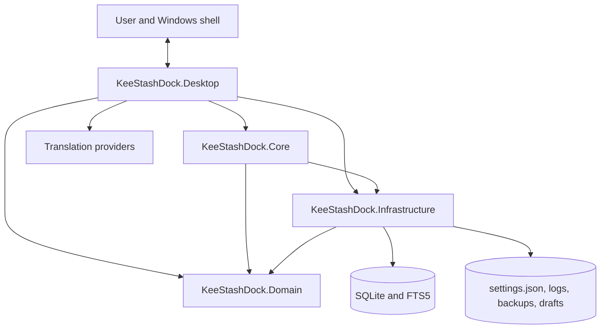
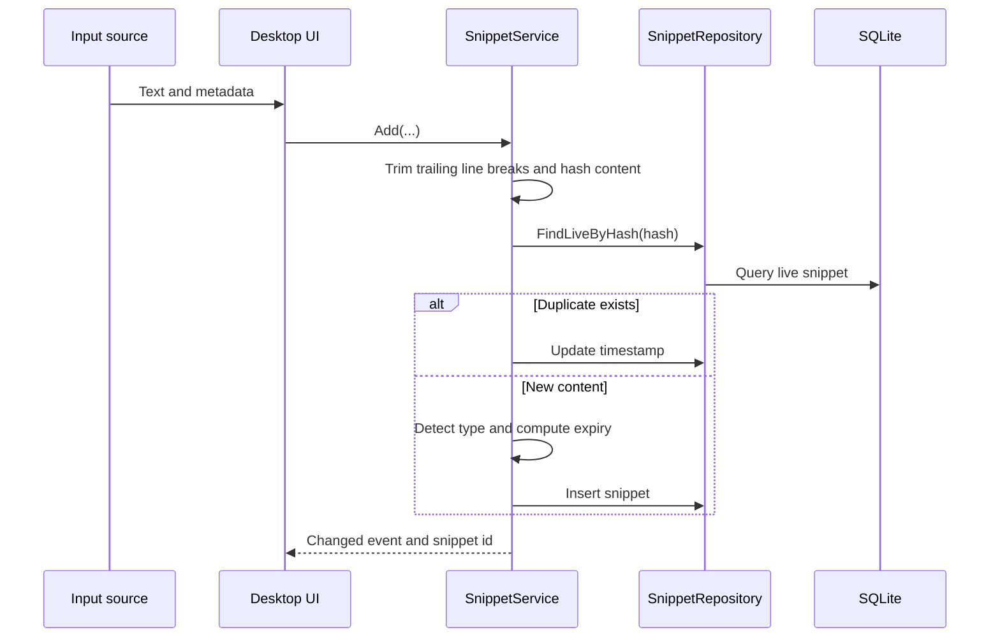

# Architecture

## Purpose

KeeStashDock is a local-first Windows desktop application for capturing, organizing, searching, transforming, and reusing text snippets. The solution separates persisted models, storage concerns, application use cases, and Windows-specific presentation code into four projects.

## Solution map

### `KeeStashDock.Domain`

The dependency-free model layer contains:

- `Snippet`, `Category`, and `Tag`
- `AppSettings`
- Persisted enums for snippet type, source, and expiry policy

Persisted enum values are database contracts. Existing values must not be reordered.

### `KeeStashDock.Infrastructure`

The storage layer contains:

- SQLite connection setup with WAL, foreign keys, normal synchronization, and a busy timeout
- Ordered schema migrations
- Snippet, category, and tag repositories
- FTS5 virtual table and synchronization triggers
- Atomic JSON settings persistence
- Portable-path resolution and `%AppData%` fallback
- Asynchronous rolling file logging
- Online SQLite backups, rolling automatic backups, and guarded import replacement

No WPF dependency belongs in this project.

### `KeeStashDock.Core`

The application-service layer contains:

- Snippet creation, deduplication, update, retention, pinning, use tracking, and trash operations
- Search routing between FTS5 and a CJK-compatible fallback
- Group package import and export
- Scheduled housekeeping
- Content-type detection
- Pure text transformations

View models should call these use cases instead of duplicating business rules.

### `KeeStashDock.Desktop`

The Windows host contains:

- WPF application lifecycle, windows, controls, and MVVM view models
- Dependency-injection composition
- System-tray integration
- Single-instance mutex and named-pipe activation
- Global hotkey registration
- Clipboard listener, low-level selection mouse hook, and synthetic input
- Quick panel, workbench, settings, sticky notes, toasts, and translation cards
- Localization and right-to-left layout handling
- Theme, wallpaper, glass, palette, and contrast behavior
- QR encoding and shell integration
- Translation provider clients

The desktop project currently references all lower layers. A future cleanup can reduce direct Domain and Infrastructure access from view models by adding narrow Core interfaces, but that should be performed incrementally with tests rather than as a cosmetic dependency rewrite.

## Core workflows

### Capture and deduplication

Empty or whitespace-only snippets are rejected. A duplicate live snippet is refreshed instead of inserted again.

### Search

The search service uses FTS5 for ordinary tokenized queries. Queries containing CJK characters use a repository `LIKE` path because default FTS tokenization does not provide reliable substring behavior for every CJK input pattern.

### Retention and deletion

- `Never` has no wall-clock expiry.
- `OneDay` and `SevenDays` calculate an absolute UTC expiry at creation or edit time.
- `BurnAfterRead` moves the snippet to Trash after the first registered use.
- Expired snippets and normal deletions use soft deletion first.
- Housekeeping performs expiry, trash purging, and scheduled backups.

### Translation

Selection translation is initiated in the desktop layer. The selected text is sent to the configured provider and the translated result is shown in a temporary card. Three providers use keyless public endpoints; DeepL uses the user's API key. Provider failure is expected and should remain a non-fatal UI error.

### Data and backup

The application first attempts to create `Data` beside the executable and verifies actual file writability. It falls back to `%AppData%\KeeStashDock` after access or I/O failure. SQLite's online backup API is used for consistent backups while the application is running. Imports create a safety backup before replacing the active database.

## Database schema

Schema version 1 includes:

- `categories`
- `snippets`
- `tags`
- `snippet_tags`
- `snippets_fts`
- FTS synchronization triggers

Migrations are append-only. A shipped migration must never be edited because existing installations may already record it as applied.

## Configuration and localization

`settings.json` is written atomically through a temporary file and replacement or move operation. Language packs are copied next to the executable and may be edited and reloaded by users. `en-US.json` is the canonical key contract; `$meta` carries display name, text direction, and optional font preference.

## Reliability and privacy boundaries

- The application is single-instance to avoid conflicting tray, hotkey, and database ownership.
- Clipboard history and direct paste are opt-in.
- Logging uses a bounded asynchronous queue and rolling files.
- Translation is an explicit external data boundary.
- User data directories, logs, database files, backups, API keys, and IDE user settings must never be committed.

## Known architectural risks

The following items deserve focused future work:

1. Validate imported databases against the expected schema before replacing the active database.
2. Enforce non-empty edited content and define duplicate-hash behavior on update.
3. Add uniqueness and conflict rules for category names.
4. Narrow Desktop dependencies through Core interfaces where doing so reduces coupling.
5. Add integration tests for SQLite migrations, FTS synchronization, backup/import, and single-instance activation.
6. Review every localized in-application help page after feature changes; key parity alone cannot detect stale translations.
7. Define, document, and secure any future plugin model before activating the reserved `Plugins` directory.
