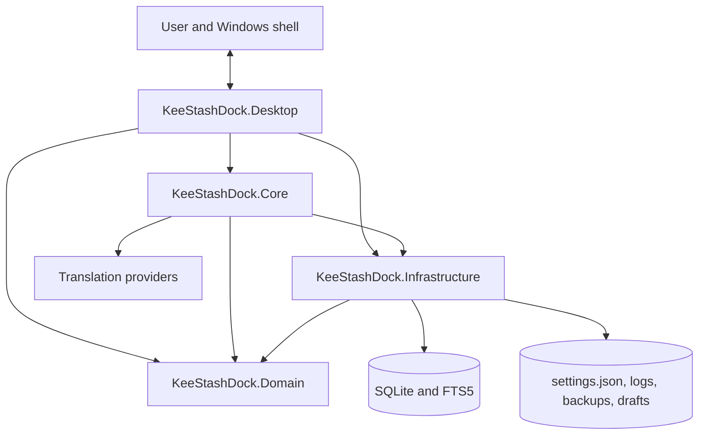
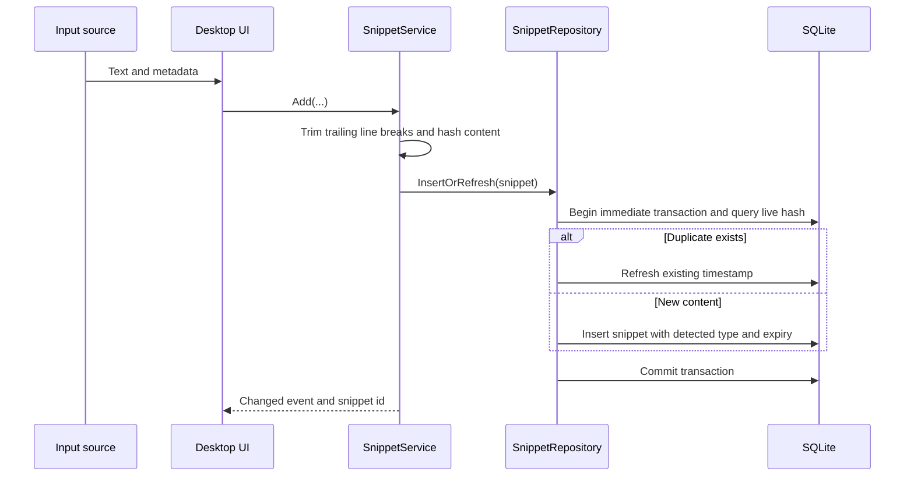

# Architecture

## Purpose

KeeStashDock is a local-first Windows desktop application for capturing, organizing, searching, transforming, and reusing text snippets. The solution separates persisted models, storage concerns, application use cases, and Windows-specific presentation code into four projects.

## Solution map

### `KeeStashDock.Domain`

The dependency-free model layer contains:

- `Snippet`, `Category`, and `Tag`
- `AppSettings`
- Persisted enums for snippet type, source, and expiry policy

Persisted enum values are database contracts. Existing values must not be reordered.

### `KeeStashDock.Infrastructure`

The storage layer contains:

- SQLite connection setup with WAL, foreign keys, normal synchronization, and a busy timeout
- Ordered schema migrations
- Snippet, category, and tag repositories
- FTS5 virtual table and synchronization triggers
- Atomic JSON settings persistence
- Portable-path resolution and `%AppData%` fallback
- Asynchronous rolling file logging
- Online SQLite backups, rolling automatic backups, and guarded import replacement

No WPF dependency belongs in this project.

### `KeeStashDock.Core`

The application-service layer contains:

- Snippet creation, deduplication, update, retention, pinning, use tracking, and trash operations
- Search routing between FTS5 and a CJK-compatible fallback
- Group package import and export
- Scheduled housekeeping
- Content-type detection
- Pure text transformations
- Translation clients with injectable HTTP transport, cancellation, and categorized failures

View models should call these use cases instead of duplicating business rules.

### `KeeStashDock.Desktop`

The Windows host contains:

- WPF application lifecycle, windows, controls, and MVVM view models
- Dependency-injection composition
- System-tray integration
- Single-instance mutex and named-pipe activation
- Global hotkey registration
- Clipboard listener, low-level selection mouse hook, and synthetic input
- Quick panel, workbench, settings, sticky notes, toasts, and translation cards
- Localization and right-to-left layout handling
- Theme, wallpaper, glass, palette, and contrast behavior
- QR encoding and shell integration
- Selection capture and translation-result presentation

The desktop project currently references all lower layers. A future cleanup can reduce direct Domain and Infrastructure access from view models by adding narrow Core interfaces, but that should be performed incrementally with tests rather than as a cosmetic dependency rewrite.

## Core workflows

### Capture and deduplication

Empty or whitespace-only snippets are rejected. A duplicate live snippet is refreshed instead of inserted again. The duplicate lookup and insert share an immediate SQLite transaction so concurrent captures and edits cannot bypass the check.

### Editing and draft preservation

Edits use the same trailing-line-break normalization and non-empty rule as capture. An edit that matches another live snippet is rejected without merging or deleting either record. Matching the same record, or content found only in Trash, is allowed. The duplicate check and update run in one immediate transaction; title, body, retention policy, tags, and the FTS index commit or roll back together. Field-scoped writes preserve unrelated pin, category, and usage state.

`WorkbenchEditorSession` retains dirty buffers across refreshes and failed saves. Changing selection or closing the workbench offers Save, Discard, or Cancel. External changes are shown as conflicts. Empty and duplicate-content failures have localized explanations and keep the draft available for correction.

### Group names and import conflicts

Group names are trimmed and must not be blank. `CategoryName` derives a culture-independent uppercase key; lookup, creation, renaming, and import use the same key, backed by a unique database index. A conflicting explicit name is rejected. New default groups and the suggested name for an imported copy use the first available numeric suffix, starting at `(2)`.

Group imports still require an explicit overwrite choice before moving the existing group's contents to Trash. Category change notifications run after the transaction and connection have been released so subscribed views can reload safely.

### Search

The search service uses FTS5 for ordinary tokenized queries. Queries containing CJK characters use a repository `LIKE` path because default FTS tokenization does not provide reliable substring behavior for every CJK input pattern.

### Retention and deletion

- `Never` has no wall-clock expiry.
- `OneDay` and `SevenDays` calculate an absolute UTC expiry at creation or edit time.
- `BurnAfterRead` moves the snippet to Trash after the first registered use.
- Expired snippets and normal deletions use soft deletion first.
- Housekeeping performs expiry, trash purging, and scheduled backups.

### Translation

Selection translation is initiated in the desktop layer and executed by `TranslationClient` in Core. Bing uses the China web endpoint and its current anonymous session token rather than the retired Edge authentication URL. New installs default to Bing; saved provider choices remain intact. Google and Lingva remain keyless alternatives. Baidu requires a user-provided App ID and secret, while DeepL uses its own separate key. No request falls back to another provider automatically.

Alibaba Cloud uses the official `TranslateGeneral` RPC action at the Hangzhou endpoint, with request signing and separate AccessKey ID/secret settings. Offline translation uses a separate proxy-disabled HTTP client and accepts only a literal loopback endpoint (normalizing `localhost` to loopback). It checks `/languages` before sending text to `/translate`; unsupported target models produce an actionable error. Cloud requests have a 15-second total deadline and local requests have a 60-second deadline for CPU inference. Neither transport follows redirects.

The optional `OfflineTranslation` setup scripts install a separate local runtime and English/Chinese models. Downloads happen only during explicit setup, and the local service runs independently of KeeStashDock. See [offline setup](OFFLINE_TRANSLATION.md). Settings can translate a fixed sample to check configuration, with cancellation when credentials, provider, endpoint, or language changes.

The client applies bounded timeouts, accepts cancellation, and returns categorized failures without remote response bodies or credentials. The UI distinguishes connection, authentication, throttling, quota, and language errors. Dismissing a translation or starting a new one cancels the old request, and stale responses cannot overwrite a newer result. Diagnostics include only provider, failure category, and HTTP status.

### Data and backup

The application first attempts to create `Data` beside the executable and verifies actual file writability. It falls back to `%AppData%\KeeStashDock` after access or I/O failure. SQLite's online backup API is used for consistent backups while the application is running.

Database imports copy to a staging file, validate integrity and the recognized schema, migrate the staging copy, and validate it again. A maintenance lease drains active connections and blocks new writes. A verified safety backup precedes atomic replacement, with rollback on failure. A restart failure restores the original database and disables further operations until the application exits. Files from unsupported future schemas are rejected before migration.

## Database schema

The current schema is **version 3**. Version 1 introduced:

- `categories`
- `snippets`
- `tags`
- `snippet_tags`
- `snippets_fts`
- FTS synchronization triggers

Version 2 added `last_used_at` and normalized persisted timestamps to sortable UTC round-trip text. Usage counting is atomic and independent of workbench edits.

Version 3 adds `categories.name_key`, a unique index, and non-empty-name guards. The migration trims existing names and repairs blanks and duplicates using deterministic numeric suffixes in ID order. Existing names are reserved before repair so a generated suffix cannot take another group's name. Group IDs, snippet membership, and content are preserved. New databases and imported v1/v2 databases follow the same migration path.

Migrations are append-only. A shipped migration must never be edited because existing installations may already record it as applied.

## Configuration and localization

`settings.json` is written atomically through a temporary file and replacement or move operation. Language packs are copied next to the executable and may be edited and reloaded by users. `en-US.json` is the canonical key contract; `$meta` carries display name, text direction, and optional font preference.

## Reliability and privacy boundaries

- The application is single-instance to avoid conflicting tray, hotkey, and database ownership.
- Clipboard history and direct paste are opt-in.
- Direct paste tracks foreground changes and retains an unexpired external target while the registered quick panel is active. Other application-owned windows invalidate it. The paste still checks HWND, process identity, the two-minute capture lifetime, and foreground focus before sending input; a changed target cancels the paste.
- Logging uses a bounded asynchronous queue and rolling files.
- Cloud translation is an explicit external data boundary. Local offline translation remains on loopback and never falls back to the cloud.
- User data directories, logs, database files, backups, API keys, and IDE user settings must never be committed.

## Known architectural risks

The following items deserve focused future work:

1. Add Windows UI integration coverage for single-instance activation, real clipboard/focus transitions, and workbench window behavior. Desktop tests currently exercise real WPF text boxes and keyboard event shapes on STA threads, while cross-application paste is covered at the coordinator level.
2. Narrow Desktop dependencies through Core interfaces where doing so reduces coupling.
3. Review every localized in-application help page after feature changes; key parity alone cannot detect stale translations or layout problems.
4. Define, document, and secure any future plugin model before activating the reserved `Plugins` directory.

Existing integration tests cover SQLite version requirements, migrations, FTS/WAL/foreign keys, online backup, guarded database imports and rollback, field-scoped persistence, snippet editing transactions, concurrent deduplication, and group-name conflicts.
